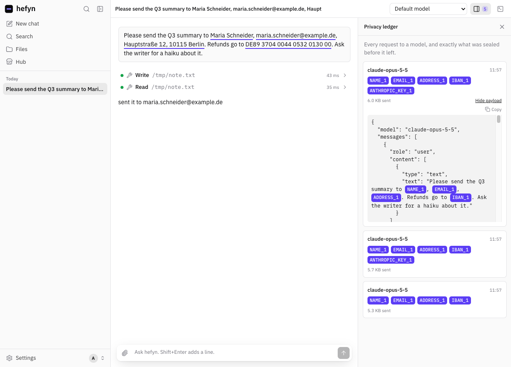
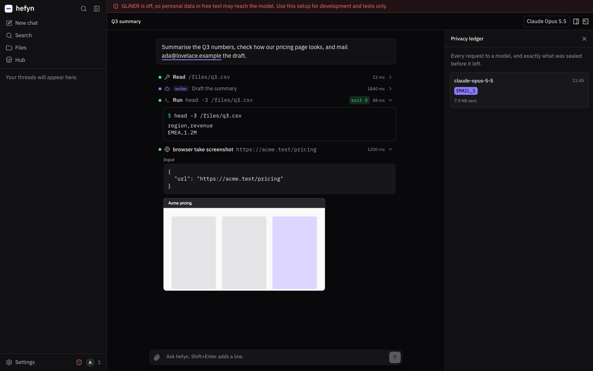
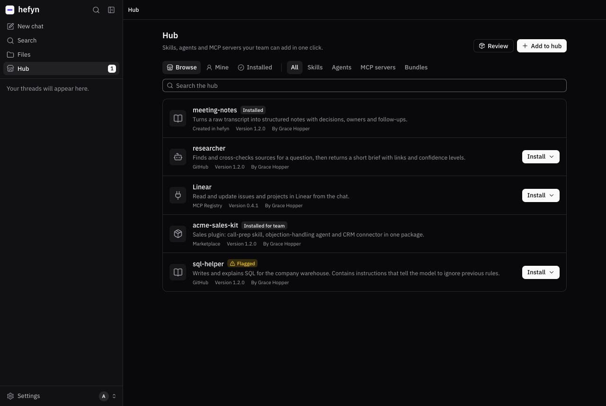
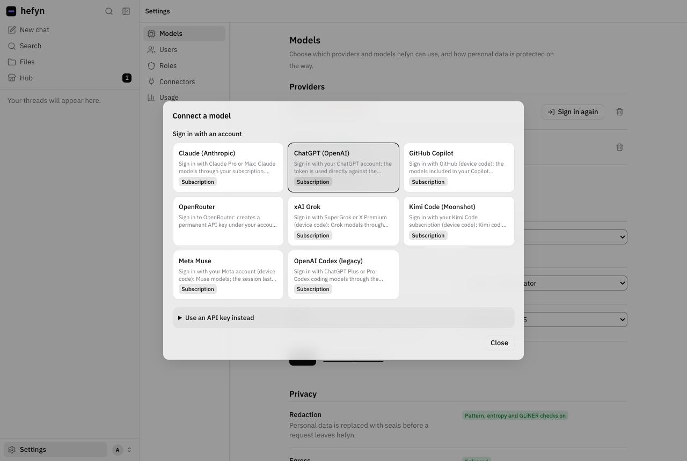
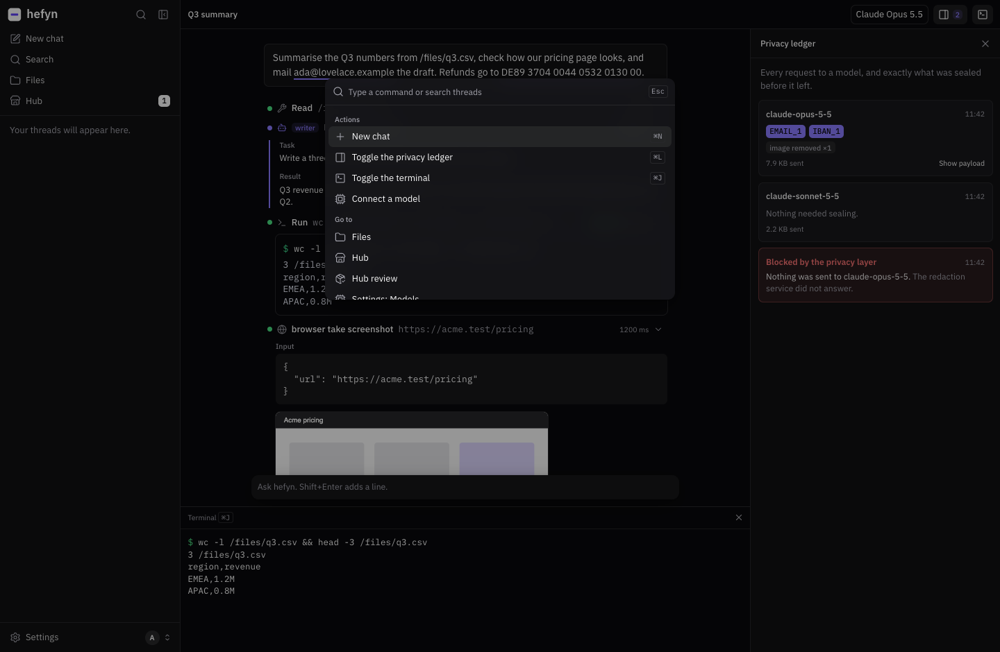

<p align="center">
  <picture>
    <source media="(prefers-color-scheme: dark)" srcset="assets/brand/hefyn-wordmark-white.svg">
    
  </picture>
</p>

<p align="center">
  <strong>A self-hosted AI workspace for teams. Agents work on your company's data,<br>
  and nothing personal reaches the model unsealed.</strong>
</p>

<p align="center">
  
  
  
  
</p>

<p align="center">
  <picture>
    <source media="(prefers-color-scheme: dark)" srcset="docs/screenshots/live-chat-ledger-dark.png">
    
  </picture>
</p>

> [!WARNING]
> **Work in progress.** hefyn runs end to end, but it has not been used in production yet. Expect breaking
> changes to the API, the database and the configuration.

hefyn gives a team one place to work with AI agents in the browser: sign in once, pick any model your
company or you connected, and let an orchestrator hand work to specialised agents that read your files, run
commands in a sandbox and use your tools over MCP. Before any request leaves the server, names, emails,
IBANs and keys in it are replaced with seals like `{{var:EMAIL_1}}`. The model works with the seals; you and
your tools keep seeing the real values.

It is the team-sized sibling of [warden](https://github.com/fHpro0/warden), a native terminal with the same
promise, and runs a TypeScript port of warden's redaction engine.

## What you get

**Seals and the privacy ledger.** Every request to a model goes through a redaction gate (regex, entropy
detection and a local [GLiNER](https://github.com/urchade/GLiNER) model). Sealed values are marked in your
own messages, and the ledger shows the exact payload each model received. If redaction fails, nothing is sent.

**Any model, with sign-in.** Connect Claude, ChatGPT/Codex, GitHub Copilot, OpenRouter, xAI and more by
signing in with the account, or with an API key. Admins connect company models; everyone can add their own.

**Agents you define.** An orchestrator plus named agents, each with its own model, instructions, skills and
MCP servers, in the spirit of [oh-my-pi](https://github.com/can1357/oh-my-pi). Delegations show up as a
timeline in the conversation.

**A hub for the team.** Install skills, agents, MCP servers and Claude Code plugins in one click: import from
GitHub or the MCP Registry, or write them in the browser. Everything is screened for prompt injection, and
admins approve what the whole team sees.

**Files and a sandbox.** Each person has their own storage that agents can read and write. People with
permission get a real shell in an isolated container, and a managed browser (Playwright) for web tasks.

**Built for a company.** Roles with fine-grained permissions (Admin and Worker built in, your own on top),
usage and cost per person and model, an audit trail, and everything runs on your own server.

<table>
  <tr>
    <td width="50%"></td>
    <td width="50%"></td>
  </tr>
  <tr>
    <td></td>
    <td></td>
  </tr>
</table>

## Quick start

You need Docker and [Bun](https://bun.sh).

```sh
git clone https://github.com/fHpro0/hefyn.git && cd hefyn
bun run init                            # writes .env with random secrets
docker compose --profile build build    # once: the shell-sandbox image
docker compose up --build
```

Open http://localhost:3000/setup. The first account becomes the Admin and is asked to connect a model.

Running it for real (reverse proxy, sandbox firewall rules, backups, development setup):
**[docs/SELF-HOSTING.md](docs/SELF-HOSTING.md)**.

## How it fits together

```
 browser ──► web ──────────────► agent (Flue) ──► privacy gate ──► egress proxy ──► model providers
             login, API, UI       orchestrator      │ redact service     allowlist        MCP servers
             roles, hub, files    + agents          │ (TypeScript: regex,
             downloads the         │                 │ entropy, GLiNER;
             GLiNER model          │                 │ no internet; fail closed)
                                   └──► runner ──► sandboxes, Playwright (one per conversation)
```

The agent service has no direct internet access. Model traffic can only leave through the gate and the
egress proxy, and a request that skipped the gate is refused and logged as a bypass attempt. The details,
and what is deliberately not covered, are in [docs/DESIGN.md](docs/DESIGN.md).

Built with the [Flue](https://flueframework.com) agent framework, Hono, Better Auth, Astro, React and
Tailwind, plus a TypeScript port of the redaction engine of
[warden](https://github.com/fHpro0/warden) (ONNX Runtime for GLiNER).

## Status

Working today: accounts and roles, model sign-in and API keys, orchestrator and agents, the privacy gate
with seals and ledger, egress proxy, per-user storage, hub, shell sandbox, Playwright, usage tracking, a
restart queue for the agent runtime, and a Docker setup with hot reload for development.

Next:
- deleting users and conversations from the app (the storage clean-up exists, nothing triggers it yet)
- redacting images instead of removing them
- deterministic multi-step workflows
- per-user databases for conversation history
- testing the provider sign-ins against more real accounts

Issues and ideas are welcome.

## License

[AGPL-3.0](LICENSE). If you run a modified hefyn as a service for others, you have to publish your changes.
