<p align="center">
  <picture>
    <source media="(prefers-color-scheme: dark)" srcset="docs/readme/logo-dark.gif">
    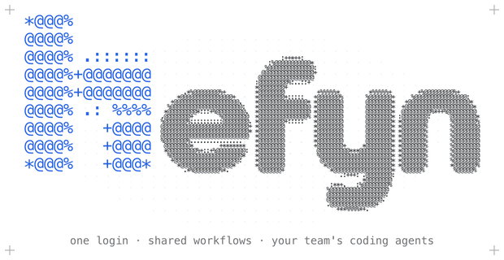
  </picture>
</p>

<p align="center">
  <strong>A self-hosted workspace where your team uses coding agents on company data.</strong>
</p>

<p align="center">
  
  
  
  
  
</p>

<p align="center">
  <a href="#quick-start">Quick start</a> ·
  <a href="#how-it-works">How it works</a> ·
  <a href="docs/README.md">Docs</a> ·
  <a href="LICENSING.md">Licensing</a>
</p>

> [!WARNING]
> **Work in progress, proof of concept.** hefyn exists to test whether the idea works. It runs end to end, but it
> has not been used in production and is not ready for real company data. Expect breaking changes to the API,
> the database and the configuration, with no migration promise.

<p align="center">
  <picture>
    <source media="(prefers-color-scheme: dark)" srcset="docs/readme/hero-dark.gif">
    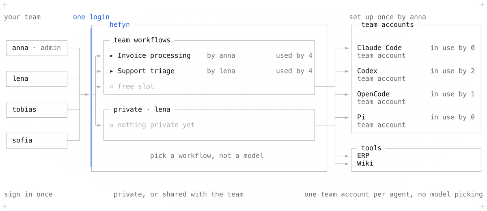
  </picture>
</p>

## What hefyn is

hefyn is a team server that hosts standard CLI coding agents (Claude Code, Codex, OpenCode, Pi) for people who do not
live in a terminal. Everyone signs in once and gets a chat view per agent, plus the agent's own terminal on the same
process. Each conversation runs in its own Docker sandbox.

hefyn runs no agent of its own. It starts the vendor's CLI in a container and shows what it does. An admin installs the
agents, connects the model keys, defines roles and adds MCP servers once; everyone else just uses them.

Model keys never enter the sandbox. The agent inside talks to a local bridge, which forwards over a unix socket to a
gateway in hefyn's agent service, and the gateway adds the real key. The agent service (and with it the model traffic of
sandboxes) reaches the internet only through an egress proxy that allows connected providers and MCP hosts. A sandbox has no route out unless an admin turns that on.

## What works today

| | |
|---|---|
| **Chat and terminal** One chat view per conversation, tool-call cards, permission questions, and a terminal view on the same agent. | **Sub-agents** Delegations show up in the chat. |
| **Assistants** Presets of an agent: name, agent, instructions, skills. | **Skills** Stored per user or shared with the team after review. |
| **Files and WebDAV** A per-user file area, also mountable over WebDAV with an app password. | **MCP servers** Added privately or shared with the team. |
| **Roles and permissions** Admin and Worker built in, custom roles with fine-grained permissions. | **Users** Add people and set their roles. |
| **Usage and cost** Per person and model. | **Agent accounts** Sign in to Claude Code with your own Claude account instead of a shared key. |
| **Devices** Pair a laptop to your account (stage 1; nothing runs there yet). | **Sign-in security** Two-factor and passkeys. |
| **Branding and appearance** Light and dark, workspace logo. | **Command palette** Keyboard-first navigation. |

## How it looks

<p align="center">
  <picture>
    <source media="(prefers-color-scheme: dark)" srcset="docs/screenshots/chat-thread-dark.png">
    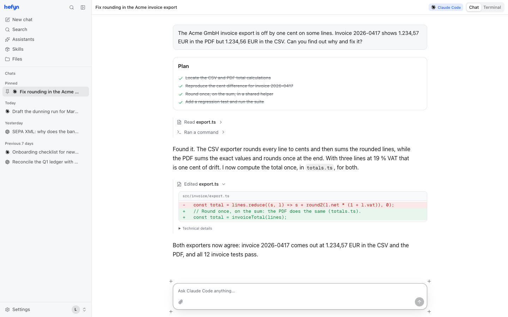
  </picture>
  <br>
  <sub>A chat with Claude Code: plan, tool calls and a diff, in the browser.</sub>
</p>

<table>
  <tr>
    <td width="50%" valign="top">
      <picture>
        <source media="(prefers-color-scheme: dark)" srcset="docs/screenshots/agents-and-keys-dark.png">
        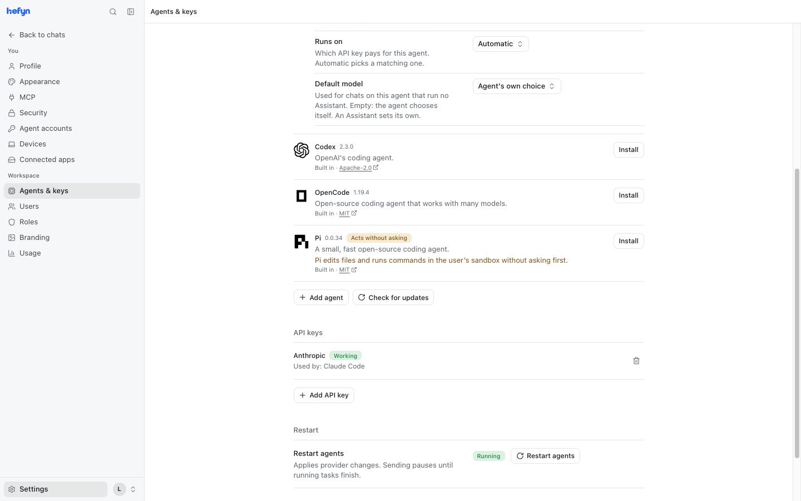
      </picture>
      <br><sub>Agents and keys: install an agent, connect what it runs on.</sub>
    </td>
    <td width="50%" valign="top">
      <picture>
        <source media="(prefers-color-scheme: dark)" srcset="docs/screenshots/assistants-dark.png">
        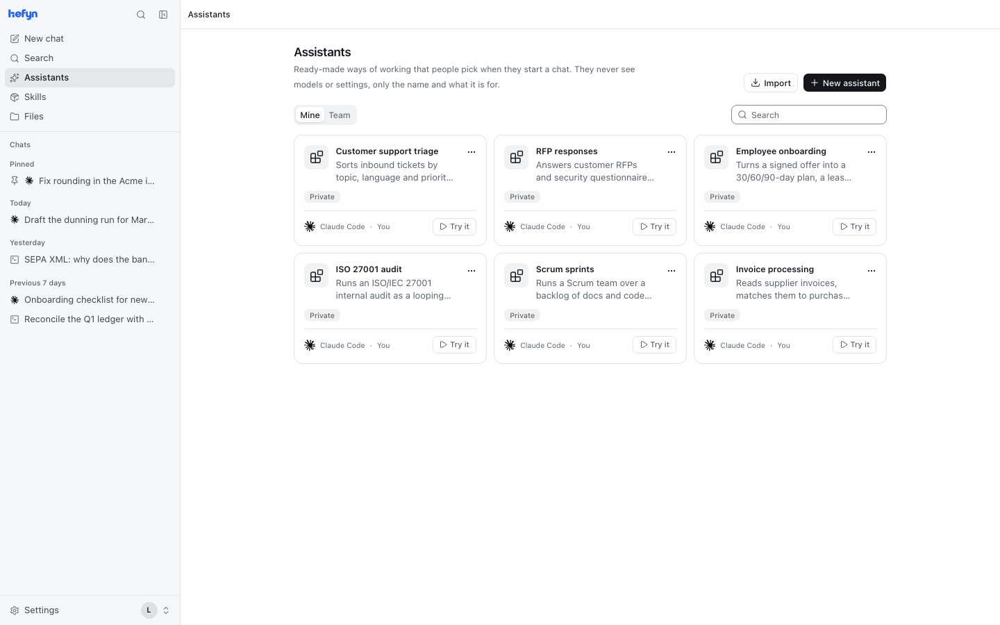
      </picture>
      <br><sub>Assistants: simple presets of an agent.</sub>
    </td>
  </tr>
  <tr>
    <td width="50%" valign="top">
      <picture>
        <source media="(prefers-color-scheme: dark)" srcset="docs/screenshots/roles-permissions-dark.png">
        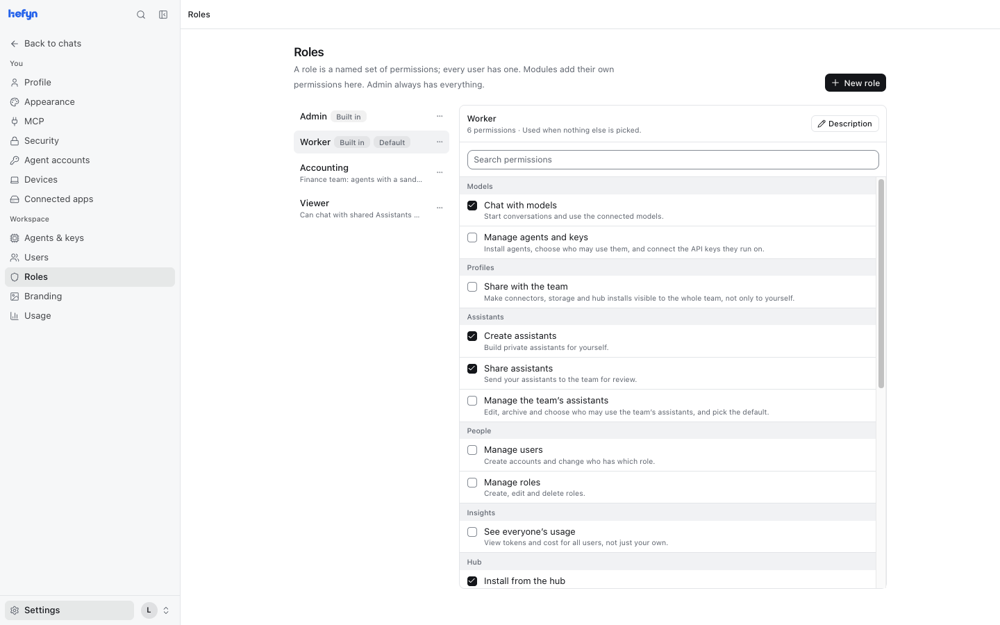
      </picture>
      <br><sub>Roles and permissions, for example who gets a sandbox.</sub>
    </td>
    <td width="50%" valign="top">
      <picture>
        <source media="(prefers-color-scheme: dark)" srcset="docs/screenshots/users-dark.png">
        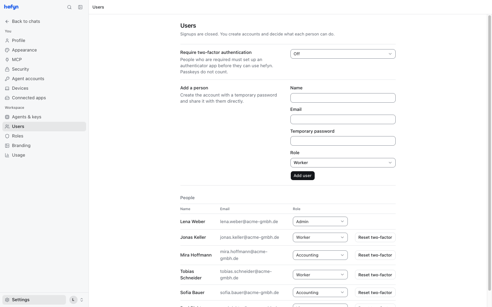
      </picture>
      <br><sub>Users and their roles.</sub>
    </td>
  </tr>
  <tr>
    <td width="50%" valign="top">
      <picture>
        <source media="(prefers-color-scheme: dark)" srcset="docs/screenshots/usage-cost-dark.png">
        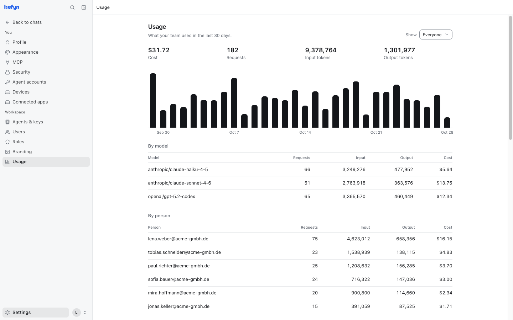
      </picture>
      <br><sub>Usage and cost per person and model.</sub>
    </td>
    <td width="50%" valign="top">
      <picture>
        <source media="(prefers-color-scheme: dark)" srcset="docs/screenshots/mcp-servers-dark.png">
        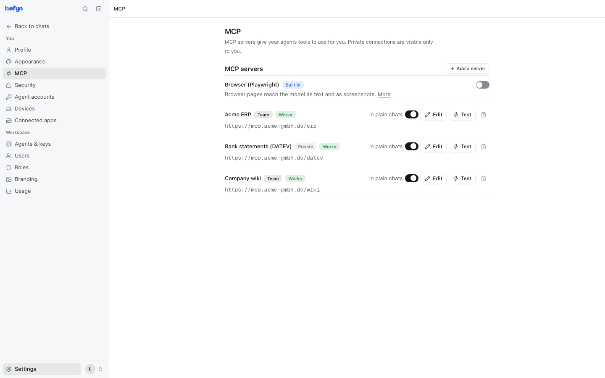
      </picture>
      <br><sub>MCP servers.</sub>
    </td>
  </tr>
  <tr>
    <td width="50%" valign="top">
      <picture>
        <source media="(prefers-color-scheme: dark)" srcset="docs/screenshots/command-palette-dark.png">
        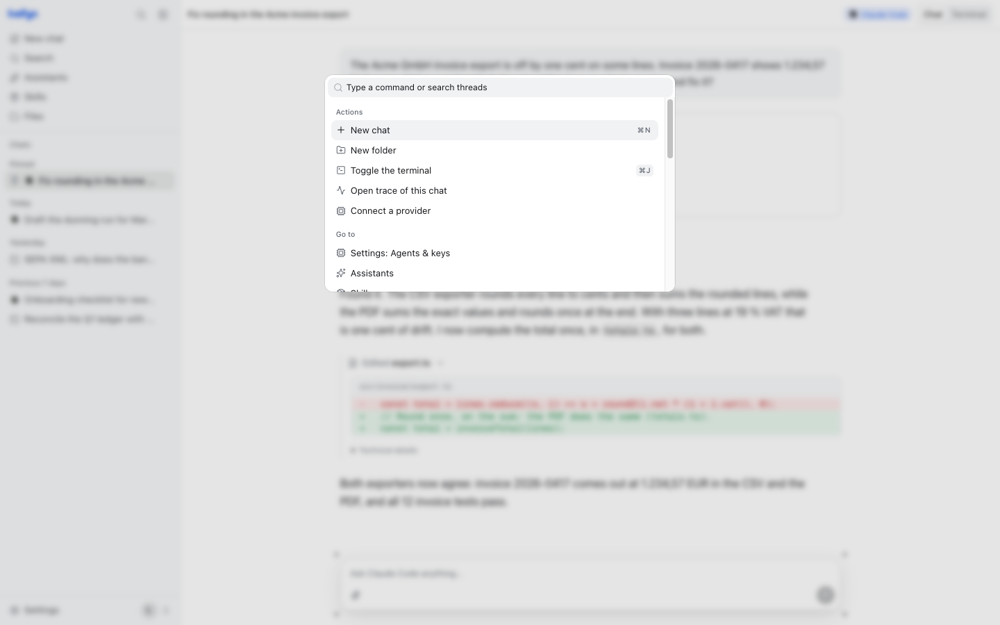
      </picture>
      <br><sub>The command palette.</sub>
    </td>
    <td width="50%" valign="top">
      <picture>
        <source media="(prefers-color-scheme: dark)" srcset="docs/screenshots/setup-dark.png">
        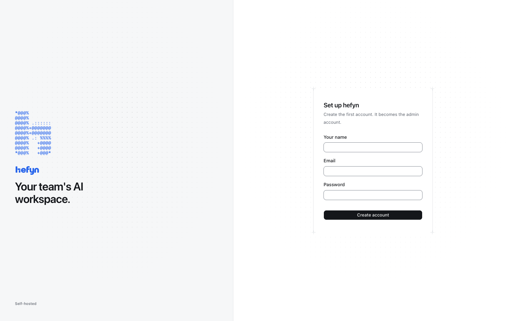
      </picture>
      <br><sub>First-run setup: the first account becomes Admin.</sub>
    </td>
  </tr>
</table>

## How it works

Only `web` is published. The agent and the runner sit on the internal `core` network, which has no route to the
internet. `web` and the egress proxy bridge `core` and the internet; `web` also reaches out itself (for example to fetch
the ACP agent registry), while the agent leaves only through the egress proxy. Sandboxes run on a separate internal
network the runner creates, with no route out by default.

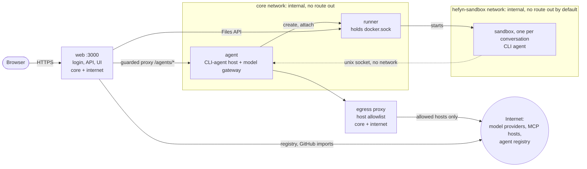

A chat turn, with a provider API key connected:

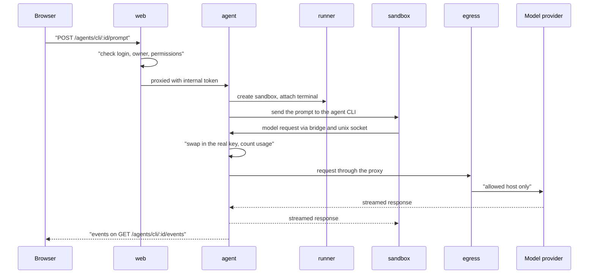

More in [docs/DESIGN.md](docs/DESIGN.md), [docs/SANDBOX.md](docs/SANDBOX.md) and [docs/WRAPPER.md](docs/WRAPPER.md).

## Security and privacy at a glance

- Stored keys and user data are encrypted at rest with AES-256-GCM.
- The default key mode is `server`: it protects a stolen database or backup, but not someone who holds both `.env` and the database, or the running server. `user` mode exists, but its unlock UI is not part of this build.
- Admins cannot read other users' chats through the app; they see metadata (ids, timestamps, usage, model names).
- Sandboxes have a read-only root filesystem, `cap_drop ALL` and no route out by default. Turning on sandbox internet (`HEFYN_SANDBOX_EGRESS=internet`) makes it an exfiltration channel.
- Model requests reach the provider as they are. There is no redaction layer.
- Anyone with root or Docker access on the host can read everything.

Details and limits: [docs/ENCRYPTION.md](docs/ENCRYPTION.md), [docs/SANDBOX.md](docs/SANDBOX.md).

## Quick start

You need Docker with Compose v2 and [Bun](https://bun.sh) (only for `bun run init`).

```sh
git clone https://github.com/fHpro0/hefyn.git && cd hefyn
bun run init                           # writes .env with random secrets
docker compose --profile build build   # builds the sandbox image (required: no chat starts without it)
docker compose up -d --build
```

Open http://localhost:3000. The first account becomes the Admin and sign-ups close afterwards. Then, under
**Settings > Agents & keys**, install an agent and connect the key it runs on. Reverse proxy, firewall rules and
backups: [docs/SELF-HOSTING.md](docs/SELF-HOSTING.md).

## Configuration

`bun run init` creates `.env` from `.env.example`. The variables you are most likely to touch:

| Variable | Purpose |
| --- | --- |
| `HEFYN_SECRET` | Signs sessions and, in `server` key mode, roots the encryption of stored data. Generated by `init`; losing it makes stored keys unreadable. |
| `HEFYN_INTERNAL_TOKEN` | Shared secret between the services. Generated by `init`. |
| `HEFYN_URL` | Public URL users open (cookies, CSRF, passkeys). Default `http://localhost:3000`. |
| `HEFYN_SANDBOX_EGRESS` | `none` (default, no route out) or `internet` (opt-in). |
| `HEFYN_KEY_MODE` | `server` (default) or `user`. |
| `HEFYN_DRAIN_TIMEOUT_MS` | How long an agent restart waits for running turns (default 600000). |
| `HEFYN_RUNNER_MAX_SANDBOXES_PER_USER` | Sandbox limit per user (compose default 8). |

The full list is in [docs/SELF-HOSTING.md](docs/SELF-HOSTING.md) and [docs/SANDBOX.md](docs/SANDBOX.md).

## For developers

```
src/        Hono server, CLI-agent host and gateways, Cordis kernel, modules
web/        React console (bundled by Bun: web/serve.ts dev with HMR, web/build.ts for dist/web)
services/   egress proxy, sandbox runner, sandbox image
profiles/   agent profiles
device/     laptop CLI for pairing
test/       tests, run by bun
docs/       design and operations docs
old/        retired features (not built, not tested, not shipped)
```

```sh
bun install
bun run dev          # agent :5174, web API :5173, UI :4321
bun run typecheck
bun run test         # each test file in its own `bun test` process
bun run dev:docker   # the same with hot reload in Docker
```

`bun run readme:art` regenerates the README's ASCII logo and diagram (needs ffmpeg, rsvg-convert and ImageMagick).

Bun 1.4.4 or newer; the servers run the TypeScript sources directly. See [CONTRIBUTING.md](CONTRIBUTING.md) and the [docs index](docs/README.md).

## Roadmap

| Built | Planned |
|---|---|
| CLI-agent host with chat and terminal views | Devices stage 2: agents running on the user's laptop |
| Sub-agents, Assistants, skills, MCP servers | An `AgentAdapter` boundary per agent kind |
| Agents and keys, gateways, agent accounts | Event-sourced orchestrator |
| Roles, users, 2FA and passkeys | Projects and per-turn checkpoints |
| Egress proxy, runner, sandboxes | Plan mode and permission modes |
| Files and WebDAV, usage and cost | Playwright browser for chats (container exists, not wired) |
| Devices pairing (stage 1), Cordis kernel and modules | Installed modules with code, Creator mode |

The stages are laid out in [docs/HARNESS.md](docs/HARNESS.md).

## Editions and license

| | Community | Enterprise | Cloud |
|---|---|---|---|
| Status | This repository | Planned | Planned |
| What | The full workspace under the AGPL-3.0 | Extra modules for larger organizations, separate proprietary license | hefyn hosted by the maintainer |
| Price | Free | Subscription | Subscription |

You may use, modify and self-host hefyn, including commercially. If you offer a modified version to users over a
network, you must publish its source under the AGPL. Organizations that cannot accept that can buy a commercial
license. Contributions are accepted under the [CLA](CLA.md). Details: [LICENSING.md](LICENSING.md).

---

AGPL-3.0-only © Frederick Hörner
