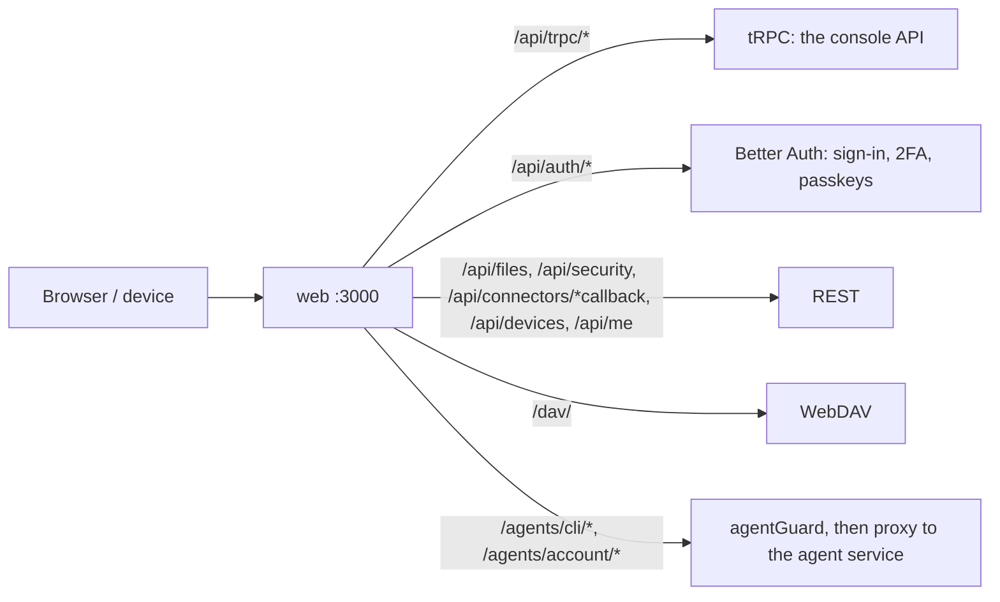

# API

A reference for the HTTP surface the web service exposes. It is the console's own API: it changes with the console, with no stability promise. Everything is checked against `src/` (routers in `src/server/routers/`, REST in `src/server/*-routes.ts`, `src/cli-agents/routes.ts`).

Sign-up is closed (`POST /api/auth/sign-up/*` answers 403); accounts come from `setup.create` (first Admin) or an admin (`users.create`).

## Conventions

- Session cookie from Better Auth. Auth for every route is `authorize()` in `src/server/guard.ts`: session, then the two-factor / password-change gate, then permissions (any-of).
- **Gate:** while two-factor setup is required, or an admin chose the account's password, every route except `/api/me` and `/api/security/*` answers `403 {"error":"2fa_setup_required"}` or `{"error":"password_change_required"}`.
- **Locked key:** REST answers `423 {"error":"locked","scope":"user"|"team"}`; tRPC answers HTTP 412 (`PRECONDITION_FAILED`, `message: "locked"`, `data.scope`). In the default key mode this does not occur in normal use (see ENCRYPTION.md).
- **tRPC:** `/api/trpc/<router>.<procedure>`. Queries are `GET ?input=<json>`, mutations `POST` with a JSON body (a non-JSON POST is 415, a mutation over GET is 405). Responses are `no-store`. Errors are `{ error: { message, data: { code, scope?, details? } } }`; zod failures read `path: message`. Types come from `AppRouter` (`src/server/router.ts`). In the lists below "signed in" means any session past the gate; otherwise the permission is named (any-of).
- Permissions are listed in `src/server/permissions.ts` and in each module's `permissions` (`src/modules/builtin.ts`). Worker defaults: `models.use`, `hub.install`, `assistants.create`, `assistants.share`, `sandbox.shell`, plus modules' own (`devices.connect`). Admin has everything.

## Public (no session)

- `setup.status` (tRPC) -> `{ needsSetup, providerConnected, mailConfigured }`. `setup.create { name, email, password }` works only while there are no users (409 afterwards).
- `brand.get` (tRPC): the instance name and logos.
- `POST /api/devices/pair { name, code, secretHash }` (201 `{ expiresAt }`; 400 bad input, 409 code or hash taken, 429 throttled, 503 too many pending). `GET /api/devices/self` and `DELETE /api/devices/self` with `Authorization: Bearer <secret>` (self: 202 pending, 200 `{ id, name, user }`, 410 expired, 401 unknown; delete: 204). The console side is `devices.*`. See [DEVICES.md](DEVICES.md).
- `GET /internal/egress-allowlist` and everything under `/agents/*` between services use the internal token and are not for clients.

## `GET /api/me`

Signed in (stays REST because the gate lets it through). Returns the user with `role`, `roleId`, `permissions`, `twoFactorEnabled`, `twoFactorSetupRequired`, `passwordChangeRequired`, `providerConnected`, `modelReady`.

## Auth, two-factor, passkeys

Better Auth's own routes under `/api/auth/*` (`/sign-in/*`, `/two-factor/*`, `/passkey/*`, `/request-password-reset`, `/reset-password`). hefyn adds:

- `users.twoFactorPolicy` / `users.setTwoFactorPolicy { policy: "off" | "admins" | "everyone" }` (`users.manage`).
- `users.resetTwoFactor { id }` (`users.manage`): disables TOTP and deletes backup codes and passkeys; 409 for your own account.
- `users.create { name?, email, password?, roleId?, invite? }` with `invite: true` and system mail configured sends a "set your password" mail (`invited: true` in the answer). System mail cannot be configured in this build (see SELF-HOSTING.md), so invites fall back to the temporary password.

### Key flows: `/api/security/*` (REST, exempt from the gate)

Defined in `src/server/security-routes.ts`; behaviour in [ENCRYPTION.md](ENCRYPTION.md). The console uses only `reset-data`, `team-pending` and `team-grant`; the rest is the user-mode unlock API whose screens moved to `old/`.

| Route | Permission | |
|---|---|---|
| `GET /key-status` | signed in | `{ unlocked, state, keyMode, isAdmin, teamUnlocked, passkeyUnlock, recoveryKeyToShow?, teamRecoveryKeyToShow? , ... }` |
| `POST /unlock` | signed in | unlock with the password (and recovery key after a reset) |
| `POST /passkey-unlock` | signed in | open the key with a passkey PRF output |
| `POST /passkey-prf/challenge`, `/enroll`, `/remove` | signed in | enrol or remove passkey unlock |
| `POST /recovery-key/rotate` | signed in | new recovery key |
| `POST /reset-data { password, confirm }` | signed in | "Delete my data": deletes chats, connections, personal credentials; returns the new `recoveryKey` |
| `POST /team-unlock` | `users.manage` | open the team key with the instance recovery key |
| `GET /team-pending`, `POST /team-grant { userId }` | `users.manage` | admins waiting for team-key access, and confirm one |

## Runtime and restart queue

State machine (in `app.db`): `running -> draining -> restarting -> running`. While not `running`, new `POST /agents/*` requests are rejected with **503** `{ state, error }`; reads and streams of existing conversations keep working while the agent process is up. The agent restarts when no task runs, or after `HEFYN_DRAIN_TIMEOUT_MS` (default 10 min).

- `runtime.info` (signed in) -> `{ state, runningTasks, agentUp, requestedAt, requestedBy }`. `agentUp` is an HTTP probe of the agent (cached 2 s); `runningTasks` is 0 while it is down.
- `runtime.restart` (`models.manage`): requests a restart (idempotent), returns the same body. A restart is also requested when a company provider is removed (`requestedBy: "system: provider removed"`). Newly connected providers need none.

## Chats

`conversations.*` (`models.use` unless noted). Every chat is a hosted CLI agent. Titles are sealed per user; no procedure returns another user's chats.

- `list { archived?, ... }` (signed in) -> own top-level chats `{ id, title, model, thinking, acceptMessages, pinned, agent, view, assistantId, flow, archivedAt, createdAt, ...activity, ...module fields }`. Hidden editor chats are not listed.
- `activity` (signed in) -> `{ [conversationId]: { state: "running" | "waiting", since?, label?, agents? } }` for own chats; idle chats are absent. No message content is read.
- `create { title?, assistantId?, agent?, view?: "chat" | "terminal" }` -> `{ id, agent, view, assistantId?, ... }`. Without `assistantId` and `agent` the default Assistant is used, or Claude Code (`claude-acp`) when it has no agent. An Assistant's agent wins over a client `agent`. A raw `agent` needs `sandbox.shell` and the agent's role. 403 for a private Assistant that is not yours or one that is not available (the message says why).
- `update { id, model?, thinking?, acceptMessages?, title?, pinned?, archived?, view?, folderId?, ... }`. Changing `model` or `thinking` needs `models.manage` (403); the model must be in `models.available`. Levels: `off, minimal, low, medium, high, xhigh, max`; `null` = default.
- `delete { id }` -> `{ ok: true }`. `bulk { ids (1 to 500), action: "delete" | "archive" | "unarchive" | "move" (folderId), ... }` -> `{ ok, count }`; all ids must be yours or nothing happens.

`folders.*` (`models.use`; per user, never shared): `list`, `create { name, parentId?, projectId?, position? }`, `rename { id, name }`, `move { id, parentId?, projectId?, position? }`, `delete { id, mode: "lift" | "delete" = "lift" }` (`delete` also deletes the subfolders and their chats). Moving a chat is `conversations.update` / `bulk`.

`mentions.*` (`models.use`): `search { q? }` -> `{ files, agents }` for the `@` popover; `link { id, files }` copies chosen files into conversation `id`'s scratch folder (at most 10) -> `{ saved }`; `linkChat { id, chat }` writes another own chat as Markdown into the scratch folder. `link` with `chats` is refused ("not available any more").

### Hosted agent routes: `/agents/cli/<conversationId>/...`

Not tRPC. The web service checks the session, `models.use`, that the conversation is yours and has an agent, and that you have the sandbox (`sandbox.shell`, or an Assistant that grants the agent's sandbox to your role); then forwards to the agent service with your keys. 404 for an unknown or deleted chat; 503 while a restart is pending; 423 if the key is missing.

- `GET events?after=<seq>`: server-sent events of `{ seq, at, update }` (the chat's sealed event log, replayable).
- `POST prompt { text, theme?: "light" | "dark", lane?: { agent, action: "message" | "stop" } }` -> 202 `{ ok }`.
- `POST permission { requestId, optionId | null }` answers an agent's question; `POST cancel`.
- Terminal: `POST terminal { cols, rows, theme? }`, `GET terminal/stream` (SSE of base64 chunks; 409 if not open), `POST terminal/input { data }`, `POST terminal/resize { cols, rows }`.

`/agents/account/u_<userId>_signin/...` is the sign-in terminal of Agent accounts (one per user, needs the runner, not `sandbox.shell`): `POST open { agent, scope?: "personal" | "team", cols, rows }`, `GET state`, `POST code`, `GET stream`, `POST input`, `POST resize`, `POST close`.

Any other `/agents/*` path is 403.

## Files and attachments

Per-user storage; agents see it as `/files`, plus `/tmp` (scratch of the current chat). REST under `/api/files`, permission `sandbox.shell`, always the signed-in user's own `/files`. `path` and `dir` are relative to `/files`:

- `GET /api/files?path=` -> `{ path, entries: [{ name, type: "file"|"dir"|"symlink", size, mtime }] }`; `GET /api/files/usage` -> `{ used, quota }`; `GET /api/files/stat?path=` -> `{ path, type, size, mtime, created }`.
- `GET /api/files/download?path=`: the bytes as an attachment (`application/octet-stream`, `nosniff`, `content-security-policy: sandbox`).
- `POST /api/files/upload?dir=` (multipart, any field names) -> `{ saved: [{ name, path, size }] }`; a name that exists gets ` (1)`. 413 over `HEFYN_MAX_UPLOAD_MB` per file or over the quota.
- `PUT /api/files/content?path=[&mtime=][&new=1]` (text body, 5 MB): save from the editor; 409 if the file changed since `mtime` or exists with `new=1`.
- `DELETE /api/files?path=` (recursive), `POST /api/files/mkdir { path }`, `POST /api/files/rename { from, to }`.
- Scratch of own chats (read-only, plus clear): `GET /api/files/scratch`, `GET /api/files/scratch/:conv/{list,stat,download}?path=`, `DELETE /api/files/scratch/:conv` (409 while the chat runs) -> `{ freed }`, `POST /api/files/scratch/cleanup { olderThanDays }` -> `{ freed, chats }`. The agents' config folders (`.claude`, `.codex`, `.config`, `.pi`) are hidden.
- Errors: 400, 403 outside `/files`, 404, 409, 413; 503 when the user's sandbox container is not reachable yet.

Details and limits: [STORAGE.md](STORAGE.md). There is no attachments endpoint: upload to `/api/files/upload`, or use `mentions.link`.

**WebDAV `/dav/`** (not under `/api`; proxying in [SELF-HOSTING.md](SELF-HOSTING.md)): the user's `/files`, HTTP Basic with the account email and an app password (never the account password or a cookie), https only except localhost. Methods: OPTIONS PROPFIND PROPPATCH GET HEAD PUT DELETE MKCOL MOVE COPY LOCK UNLOCK. 401 + `WWW-Authenticate` on bad credentials, 429 after 10 failures a minute per IP and email, 403 for a read-only password on any change, 413 over the upload limit or quota.

`appPasswords.*` (`sandbox.shell`, own passwords only): `list` -> `[{ id, name, prefix, write, createdAt, lastUsedAt }]` (never the secret); `create { name, write }` -> `{ password }` (shown once; 409 beyond 20); `revoke { id }`.

`connections.*` (`sandbox.shell`; Files connections: webdav, sftp, ftp, mcp; scoped to the caller; behaviour in STORAGE.md):

- `kinds` -> `[{ kind, label, fields: [{ name, label, type, required?, hint?, options? }] }]`; `secret` fields go in `secrets`, the others in `config`.
- `list`, `status { id }` -> `{ id, kind, name, folder, path, config, secretsSet, remoteRoot, status: "new"|"ok"|"error", syncing, lastSyncAt, lastError, lastSummary, hostKey, createdAt }`. Secret values are never returned.
- `create { kind, name, config, secrets, remoteRoot? }` tests the connection first (400 `Could not connect: ...`; 409 if the folder name is taken). `update { id, name?, config?, secrets?, remoteRoot? }` (a blank secret keeps the stored one). `delete { id, keepLocalCopy }` (the remote is never touched). `test { id }` -> `{ ok, entries?, readonly?, error? }`. `syncNow { id }` -> summary; 409 while a sync runs.

## Assistants (`assistants.*`)

An Assistant is a preset people pick when they start a chat: an agent, optional provider/model/effort, instructions, skills, MCP servers and helper agents, plus input limits. It is a row of `profiles`; the seeded `default` one is the default Assistant. The flow builder is retired (`old/`): only "simple" Assistants (one agent, replying with its text) can be chatted with; an old flow Assistant is listed under `editable` with `simple: false` and can be converted.

Permissions: `assistants.create` (private Assistants), `assistants.share` (send one to team review), `assistants.manage` (team Assistants, `setDefault`). A private Assistant is visible only to its owner, even to admins. A team Assistant is visible to the roles it lists (empty = everyone). Provider, model and effort fields are for `models.manage`; anyone else gets nulls and keeps stored values.

- `list` (signed in) -> `[{ id, name, description, icon, agent, isDefault, owner: "me"|"team", inputs, available, reason? }]`. `editable` (signed in) -> own private plus (with `assistants.manage`) team Assistants `{ ..., scope, shareStatus, archived, updatedAt, simple }`. `get { id }` -> full view with `roles`, `version`, `instructions`, `skills`, `mcp`, `helpers`, `files`, `bundledSkills`, `process`; 404 for anything you may not edit.
- `options` (`assistants.create` or `.manage`) -> what can be picked: `agents`, `models`, `thinking`, `skills`, `mcp`, `roles`, `canChooseModels`.
- `save { id?, draftId?, name, description, icon, inputs, roles, scope?, agent, provider?, model?, thinking?, instructions?, skills?, mcp?, helpers? }` -> `{ id, version, errors }`. A new Assistant is private unless the caller has `assistants.manage` and passes `scope: "team"`. With `draftId` the editor's folder is stored as the Assistant's bundle (tar.gz; caps: 1000 files, 10 MB unpacked, 255 characters per path; text files only). `settings { id, roles?, provider?, model?, thinking? }` changes only those (model fields need `models.manage`).
- `archive { id, archived }`, `remove { id }` (never the default; chats on it fall back to the default), `setDefault { id }` (`assistants.manage`, team only), `convertRetired { id }`, `admin.list` (`models.manage`, deprecated).
- Sharing: `share { id }` (`assistants.share`) puts a Hub package `asst_<id>` (kind `assistant`) in review (409 while pending); `review { id, decision: "approve" | "decline", note? }` (`hub.approve`) creates or updates the team copy `t_<id>`. See [HUB.md](HUB.md).
- Editor drafts (a hidden creator chat whose sandbox folder holds the draft as files): `draft.start { draftId, agent, draft, assistantId? }`, `draft.read { conversationId, draft }`, `draft.files` / `draft.file { draftId | id, path }`, `draft.write { draftId, path, text, expect? }`, `draft.remove`, `draft.rename`, `draft.discard { draftId, keepCreator? }`, `import { draftId?, agent?, url? | zip?, path? }` (GitHub/GitLab URL or base64 zip, 10 MB), and the test chat `test.start { draftId, draft, assistantId?, scope? }`, `test.turns { id }`, `test.end { id }`. All need `assistants.create` or `.manage` and a reachable sandbox (502 otherwise).
- `inputs`: `{ images: "off"|"on", maxImageEdge (64 to 8192), imageQuality (0.1 to 1), documents, maxUploadMb (1 to 1024) }`.

## Agents (CLI agents)

`agents.*` (`models.manage`): `models` (providers and models each installed agent can run on), `catalog` (the ACP registry merged with install state), `install { id }`, `uninstall { id }`, `checkUpdates`, `update { id, enabled?, autoUpdate?, roles?, keyProvider?, defaultProvider?, defaultModel? }`, `addModule { manifest }` / `removeModule { id }` (an agent manifest with `kind: "agent"`, through Hub review). Installs run in installer containers via the runner.

`cliAgents.*`: `list` (signed in) -> the agents installed for your role with `available` and a plain `reason`; `accounts` (`sandbox.shell`) and `signOut { agentId, scope }` (each agent's own sign-in in your sandbox); `teamAccounts` and `setTeamAccount { agentId, keyEnabled?, keyRoles?, loginEnabled?, loginRoles?, ... }` (`accounts.team`).

## Models and providers

- `models.available` (`models.use`; the list only for `models.manage`, `[]` for everyone else) -> `[{ id, name, provider, scope: "company" | "own", label }]`. `models.connected` (same). Models are an admin's choice: users pick an Assistant, not a model.
- Company providers (`models.manage`): `models.providers` -> `{ available, connected: [{ id, name, kind, status: "ok"|"expired"|"error" }] }`; `models.connect { provider, apiKey, baseUrl?, models? }`; `models.disconnect { id }`. A custom endpoint is `provider: "custom"` with `baseUrl` and `models`; private and internal addresses are refused. The agent registers new providers on its next request; removing one requests a restart.
- `profile.get` / `profile.update { model, thinking?, agents?, agentThinking? }` (`models.manage`): the default Assistant's model and effort. 400 for a model that is not from a connected provider or an unknown effort level. Resolution per run: chat's model, then the Assistant's, then the team default.
- Own connections (`connectors.*`, `models.use`, scoped to the caller): `connectors.models.providers`, `.list` (`[{ provider, name, kind, status, baseUrl, createdAt }]`; `expired` = sign in again), `.connect { provider, apiKey, baseUrl?, models? }` (the key is validated first), `.disconnect { provider }`.
- OAuth sign-in with a subscription is **closed**: `connectors.oauth.start` always answers 403 ("Connect an API key instead"). `oauth.complete` and `oauth.status` still exist, but no flow can be started. `GET /api/connectors/oauth/callback?state=&code=` is the browser redirect target (static HTML page, strict CSP).

## MCP connectors (`connectors.mcp.*`, `models.use`)

- `list` -> `[{ id, name, visibility: "private"|"team", url, transport: "streamable-http"|"sse", auth: "none"|"bearer"|"oauth", mine, connected, sharedAccount, on }]`. With `mcp.run_managed` the list starts with `builtin:playwright` (`available: false` = no runner).
- `create { name, url, transport?, visibility?, auth?, bearer? }` -> `{ id }` (`visibility: "team"` needs `profiles.edit_team`; internal and private URLs are 400). `update { id, name?, url?, transport?, visibility? }` (a new address drops sign-ins). `delete { id }` (owner or Admin). `test { id }` -> `{ ok, tools?, error? }`. `setBearer { id, bearer }` (owner; team connector: `profiles.edit_team`). `setOn { id, on }` (whether plain-agent chats get it). `setPlaywright { enabled }` (403 without `mcp.run_managed`, 409 without a runner). `oauthStart { id }` -> `{ authUrl }` or `{ connected: true }`.
- `GET /api/connectors/mcp/oauth/callback` is the browser redirect target. MCP auth uses resource-metadata discovery, dynamic client registration and PKCE; tokens refresh automatically. On a team connector with `auth: oauth` the definition is shared and tokens are per user; `bearer` is a shared account.
- A connector owned by a module is managed there: `update`, `delete` and `setBearer` answer 409.

## Skills and the Hub

- `skills.*` (signed in): `list`, `get { id }`, `save { id?, name, description, instructions, files? }` (a skill is a Hub package of kind `skill`), `remove`, `share` / `unshare` (sharing needs `skills.share`), `setOn { id, on }`.
- `hub.*` (signed in; permission checks live in `src/server/hub.ts`; contract in [HUB-API.md](HUB-API.md)): `list { q?, kind?, status?, mine? }`, `get`, `file { id, path }`, `create`, `update { id, body }`, `delete`, `import { url, ref? }`, `registrySearch`, `registryImport` and `skillsmpSearch` (`hub.install`), `publish`, `approve`, `reject { id, reason }`, `install { id, target: "me" | "team" }`, `uninstall`, `installed`, `review`. Installing an MCP package creates connector entries with `connected: false` until the user signs in. Packages of kind `module` install through the module registry (`modules.manage`).

## People, roles, modules, devices, usage, theme

- `users.*` (`users.manage`): `list`, `create`, `setRole { id, roleId }`, `twoFactorPolicy`, `setTwoFactorPolicy`, `resetTwoFactor`. `brand.set` (`users.manage`).
- `roles.*`: `list` (`roles.manage` or `users.manage`) -> `{ permissions, defaultRole, roles }`; `create { name, description?, permissions }`, `duplicate`, `update`, `delete` (members fall back to the default role), `setDefault` need `roles.manage`. Built-in roles cannot be edited or deleted (409).
- `modules.list` (signed in): `{ modules, nav, commands, permissions }` that the console builds its sidebar, settings, palette and Roles page from; entries are filtered by the caller's permissions. Installing and configuring declarative modules has no UI in this build (moved to `old/`).
- `devices.*` (see DEVICES.md): `list` and `revoke { id }` (signed in, own devices), `lookup { code }` and `approve { code }` (`devices.connect`; throttled, 429).
- `usage.me` (signed in), `usage.all` (`usage.view_all`): the last 30 days as `{ perDay, perModel, perUser }` (calls, tokens, cost; `perUser` only for `usage.all`). Model requests are forwarded as they are; there is no audit or ledger endpoint.
- `theme.get`, `theme.save` (signed in): appearance preferences.

## Adding to the API

1. A router in `src/server/routers/<area>.ts` (`export const <area>Router = router({ ... })`), registered in `appRouter` (`src/server/router.ts`). Procedure names are verbs.
2. Use `perm('x.manage', ...)` (any-of), `authed`, or `publicProcedure` only for what needs no session. `ctx.me` is the user. Reads are `.query`, writes `.mutation`.
3. Inputs are zod schemas. Throw `TRPCError` for expected errors; domain errors with a `status` (HubError, StorageError, ...) are mapped in `src/server/trpc.ts`; wrap plain user-facing `Error`s in `userFacing(...)` (a 400).
4. Client: `trpc` from `web/src/lib/trpc.ts`. Take result types from the router.
5. Tests: `trpcCall` in `test/trpc.ts`. Check with `bun run typecheck` and `bun run test`.
6. Routes that must stay REST: the Better Auth routes, OAuth callbacks (browser redirects), multipart and binary file routes, SSE streams under `/agents/*`, `/api/security/*` and `/api/me` (the gate lets only these through), the public device pairing routes.
