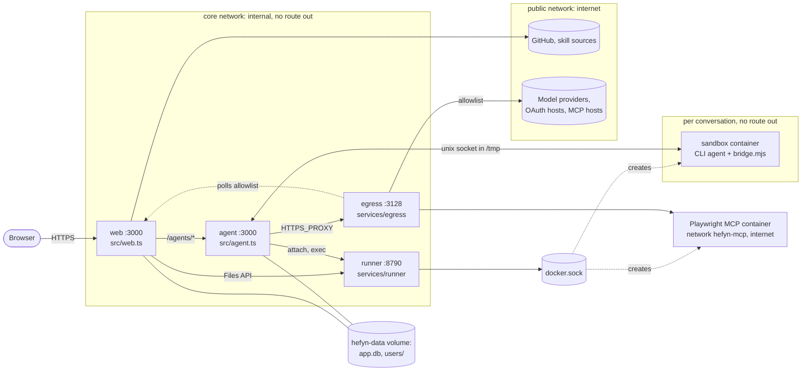
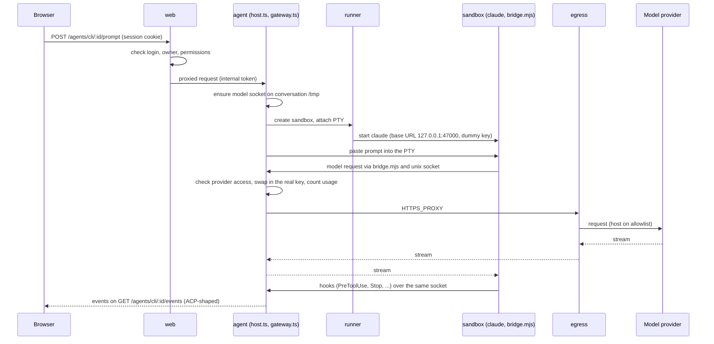

# hefyn: design

How hefyn works today. Scope and direction are in [HARNESS.md](HARNESS.md). Status: proof of concept, not used in production.

Details live in other docs: [WRAPPER.md](WRAPPER.md) (Claude Code in a PTY), [SANDBOX.md](SANDBOX.md) (runner and sandboxes),
[ENCRYPTION.md](ENCRYPTION.md) (keys and who sees what), [STORAGE.md](STORAGE.md) (files), [MODULES.md](MODULES.md), [API.md](API.md).

## Goal

A team server that hosts unmodified CLI coding agents (Claude Code, Codex, OpenCode, Pi) for people who do not live in a terminal.
One login, one chat view per agent, a terminal view on the same process, per-user sandboxes, teams and roles.
hefyn runs no agent of its own: it starts the vendor's CLI in a container and shows what it does.

Model requests are forwarded to the provider as they are (the redaction layer was removed on 2026-10-26).
What hefyn protects is stored data (encryption at rest), credentials, and who may use which provider.

Retired features (Flue chat, flow engine, collections, schedules, projects, trace, Hub UI and others) moved to `old/` on 2026-10-27.
`old/` is not built, tested or shipped, and this document does not describe it.

## Components

Source is TypeScript on Bun (pinned in `package.json`), one image for `web` and `agent`. Compose file: `docker-compose.yml`.

| Service | What it does | Network |
|---|---|---|
| `web` (`bun src/web.ts`) | Auth (Better Auth), `/api` (tRPC and Hono routes), the console (static React bundle from `web/`), WebDAV on `/dav`, the `/internal/egress-allowlist` route, and a guarded proxy for `/agents/*`. The only published service. | `core`, `public` |
| `agent` (`bun src/agent.ts`) | Hosts the CLI agents (`src/cli-agents/host.ts`), serves each conversation's model socket (gateways in `src/cli-agents/gateway*.ts`). Same image as web, separate process so it can restart (drain, then restart) without taking the UI down. | `core` only; out only through egress via `HTTPS_PROXY` |
| `egress` (`services/egress`) | Forward proxy with a host allowlist (connected providers, OAuth token hosts, MCP hosts), polled from web. Needs the internal token. | `core`, `public`, `hefyn-mcp` |
| `runner` (`services/runner`) | The only holder of `docker.sock`. Creates and limits sandbox, Playwright and agent-installer containers. Fixed images and flags; accepts nothing but its own API. | `core` |
| Sandbox container | One per conversation, started on its first run. Image built from `services/sandbox-image`. Mounts the user's `files/` at `/files`, the conversation's `tmp/` at `/tmp`, the agents volume read-only. | own Docker network, inter-container traffic off, no route out by default |
| Playwright MCP container | Browser for the model, started by the runner on request (permission `mcp.run_managed`). | `hefyn-mcp`, open internet by design |

`web` and `agent` share `app.db`. Internal calls carry `HEFYN_INTERNAL_TOKEN` (`x-hefyn-internal`).

Extension points: `src/kernel/index.ts` loads the 17 built-in modules (`src/modules/builtin.ts`, `src/modules/<id>/`) as Cordis plugins
and fails at boot when a plugin's dependency is missing. Installed modules (manifest, declarative screens, MCP) are described in [MODULES.md](MODULES.md).
Agents are JSON manifests (`src/modules/agents/*.json`: `claude-acp`, `codex-acp`, `opencode`, `pi-acp`) plus agents from the ACP Registry installed by the runner.

## One chat turn (API-key mode)

A Claude Code conversation: one PTY in the sandbox running the unmodified `claude` binary. The chat is built from its hooks and transcript
([WRAPPER.md](WRAPPER.md)). Codex, OpenCode and Pi are driven over ACP on stdio instead; the model path is the same idea.

- The sandbox only sees `127.0.0.1:47000`. `services/sandbox-image/bridge.mjs` maps it to a unix socket in `/tmp` that the agent process serves. The real key never enters the sandbox.
- The gateway (`src/cli-agents/gateway.ts` for the Anthropic API, `gateway-openai.ts`, `gateway-chat.ts` for others) refuses providers the user may not use, writes a usage row, and forwards the body unchanged. Stop in the chat aborts the turn at the gateway.
- Permission questions from the agent are answered in the chat (`POST /agents/cli/:id/permission`) or in the terminal, whichever comes first.
- Events are stored in `cli_events` (sealed per user) so a reload replays the chat.

**Own Claude account mode.** If the user signed in to Claude Code inside their sandbox (`claude auth login` in an embedded terminal), the session uses that login.
No gateway: Claude Code talks to Anthropic itself, through an HTTPS CONNECT proxy in the agent process (`src/cli-agents/own-account.ts`) that allows only
`api.anthropic.com`, `platform.claude.com` and `claude.ai`. The login lives in the user's Claude home (`users/<uid>/claude-home`, mounted as `/claude-home`); hefyn does not read it.
Unattended runs never use it. This mode has no usage rows from hefyn. See [WRAPPER.md](WRAPPER.md) and [SANDBOX.md](SANDBOX.md).

## Trust boundaries

| Boundary | Rule |
|---|---|
| Browser to web | Session cookie (Better Auth), permission checks per route, one owner per conversation. Admins see metadata only, never another user's chat content. |
| web to agent | Internal token, owner check first. The agent has no published port. |
| agent to the internet | Only through egress and its host allowlist. |
| Anything to Docker | Only the runner holds `docker.sock`. It is on an internal network, needs the token, and accepts a fixed set of images and flags. |
| Sandbox | Read-only root filesystem, `CapDrop ALL`, `no-new-privileges`, pids/memory/CPU limits, own network with inter-container traffic off, not attached to the compose network. No route out unless an admin sets `HEFYN_SANDBOX_EGRESS=internet` (an exfiltration channel for the files in it). |
| Model keys | Resolved in the agent process per request from the vault. The sandbox gets a dummy key and a loopback URL. |
| Installed modules | No server code in hefyn's processes. Declarative screens and MCP only. |
| Model provider | Sees the whole request. There is no redaction. Choose providers with that in mind. |

Outbound channels that exist on purpose: model requests (via egress), Playwright browsing, MCP servers, own-account proxy, optional sandbox internet.
Who sees what, in full: [ENCRYPTION.md](ENCRYPTION.md#who-sees-what).

## Data

| Where | What |
|---|---|
| `hefyn-data` volume, `app.db` (SQLite, `node:sqlite`, `src/server/appdb.ts`) | Users, roles, sessions, providers, conversations, `cli_events`, usage, Hub items, connectors, Assistants, devices, settings. |
| `hefyn-data`, `users/<uid>/files` | The user's persistent files; `/files` in the sandbox; the Files page; WebDAV. Quota per user. |
| `hefyn-data`, `users/<uid>/tmp/<conversation>` | Scratch space, model socket, Claude Code transcripts. |
| `hefyn-data`, `users/<uid>/claude-home` | The user's own Claude Code home (login, settings). Not sealed. |
| `hefyn-agents` volume | Installed CLI agents. The runner reads it; installer containers write it; sandboxes mount it read-only. |

Sensitive columns (conversation titles, event logs, credentials, provider keys) are sealed with AES-256-GCM.
`HEFYN_KEY_MODE` defaults to `server` (keys wrapped by a key derived from `HEFYN_SECRET`, no unlock prompts); `user` is zero-access but needs the unlock UI, which moved to `old/`.
Details and limits: [ENCRYPTION.md](ENCRYPTION.md). External storage (WebDAV, SFTP, FTP, MCP filesystem) is synced into `/files/<name>`: [STORAGE.md](STORAGE.md).

## Planned (not built)

See [HARNESS.md](HARNESS.md) for the reasoning and order.

- An `AgentAdapter` boundary (today one `CliSession` in `src/cli-agents/host.ts` handles both the PTY and ACP paths).
- An event-sourced orchestrator (today `cli_events` is a plain append).
- Projects as git directories with per-turn checkpoints (today all of a user's chats share `/files`).
- Permission and plan modes, and the thread surface around them.
- Sandboxed installed plugins with UI in iframes.
- Devices stage 2: agents on the user's laptop ([DEVICES.md](DEVICES.md); only pairing exists).
