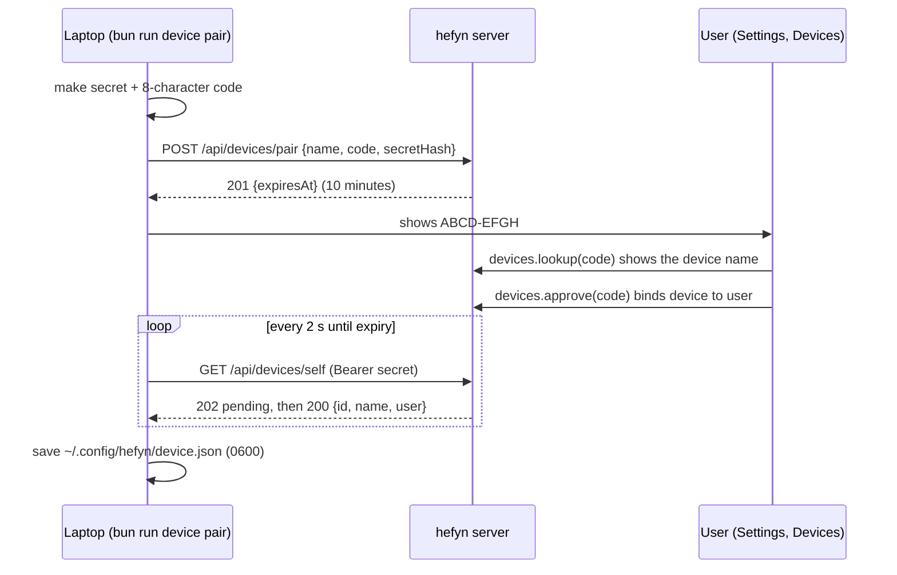

# Devices

A device is a person's own laptop, paired to their account. The goal is to let agents run there instead of in the hosted sandbox.

| Stage | State |
|---|---|
| 1. Pairing | **Built.** Settings, Devices page; public pairing routes (`src/server/devices.ts`); tRPC `devices.*` (`src/server/routers/devices.ts`); laptop CLI `device/cli.ts` (`bun run device pair <server-url> [--name <name>] | status | unpair`). |
| 2. Running agents on the laptop | **Planned.** Nothing of it exists yet. |

Stage 1 only proves which laptop belongs to which user. A paired device runs nothing and receives nothing from the server.

Permission: `devices.connect` (Worker has it by default; module `devices` in `src/modules/builtin.ts`). It gates the Devices nav entry and the `lookup` and `approve` calls. `devices.list` and `devices.revoke` need only a signed-in user.

## Pairing

The laptop mints its own secret; the server stores only its SHA-256 hash, so it never holds a usable credential.

1. `bun run device pair <server-url>` makes a random secret and an 8-character code (alphabet without `I O 0 1`), and sends `POST /api/devices/pair { name, code, secretHash }`. The code is shown as `ABCD-EFGH` and lives 10 minutes. The CLI retries up to three times if the server reports a code clash (409). The server URL must be https (http only for localhost, `127.0.0.1`, `[::1]`), because the secret is later sent as a bearer token.
2. The signed-in user opens Settings, Devices, types the code, sees the device name and confirms (`devices.lookup`, then `devices.approve`). The device is now bound to them.
3. The laptop polls `GET /api/devices/self` with `Authorization: Bearer <secret>` until it is approved: 202 pending, 200 approved (also updates `last_seen_at`), 410 expired, 401 unknown or removed. `DELETE /api/devices/self` unpairs (204).

Removing a device in the console (`devices.revoke`) deletes its row; the laptop then gets 401. Guessing is limited: 10 pairings per client IP and 10 code tries per user, per 10 minutes (in memory, reset on restart), and at most 500 pending pairings. Expired pending rows are deleted on the next pairing request or poll.

Laptop commands: `status` asks the server who the device belongs to; `unpair` tells the server (best effort) and deletes the local config. The config is `~/.config/hefyn/device.json` (or `$XDG_CONFIG_HOME/hefyn/device.json`, or `$HEFYN_DEVICE_CONFIG`), mode 0600.

Tests: `test/devices.test.ts`, `test/device-cli.test.ts`.

## Stage 2 (Planned)

The laptop would open an outbound connection to the server and run an installed agent there, shown in the web console through an `Attach` action. The server brokers it; the laptop gets no inbound port. The piece that does this does not exist yet. (`src/cli-agents/attach.ts` is not it: that file is the client of the runner's attach endpoint for the hosted sandbox, see docs/SANDBOX.md.)

Trust rules the design commits to:

- The laptop runs only agents installed on it, chosen by agent id. The server never sends a raw command.
- Only in folders the user added on the laptop.
- No Docker on the laptop.
- The agent keeps its own sign-in and permission modes.
- The server stays the source of truth for the event log, so the web console and a later phone app use the same `/agents/cli/<id>/events` API.
