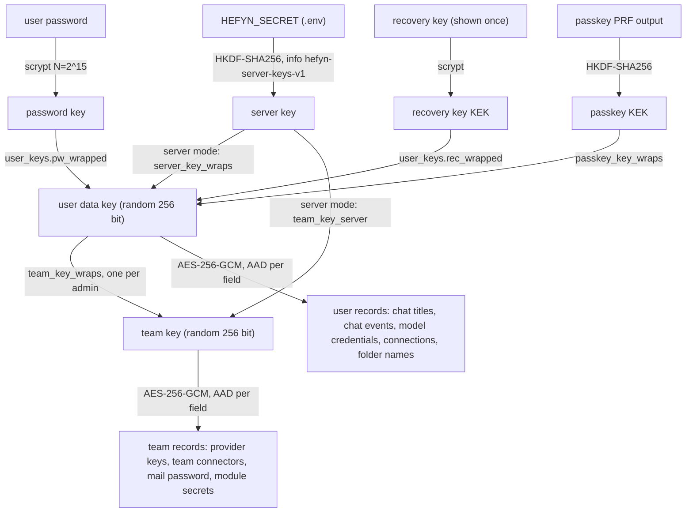

# Encryption

hefyn encrypts stored chats and secrets per user. What that protects depends on the key mode (`HEFYN_KEY_MODE`):

| | `server` (the default) | `user` (zero-access) |
|---|---|---|
| Keys wrapped by | a key derived from `HEFYN_SECRET` | the user's password (scrypt), a recovery key, optionally a passkey |
| Nothing is locked after a restart | yes | no, users unlock by signing in |
| Recovery keys | none | one per user, shown once |
| Who can read stored data | whoever has `.env` **and** the database | only the user (while signed in, also the running server) |
| Protects against | a stolen database or backup **without** `.env` | a stolen database or backup, and an operator who only reads the disk |
| Usable from the UI today | yes | **no**: the unlock UI moved to `old/` |

**Server mode is what a normal install runs.** In it, anyone who holds `.env` and `app.db` (or a backup of both) can read every chat and every secret. Keep `.env` apart from backups of the data volume.

**User mode** is the zero-access goal: "nobody but the user can read their stored chats and personal secrets, not an admin, not someone holding `app.db`". The server code for it is still there and tested (`src/server/keys.ts`, `src/server/unlock-wraps.ts`, `test/encryption.test.ts`, `test/key-mode.test.ts`), but the screens that ask for the password, show the recovery key or enrol a passkey for unlock are gone from `web/` (the console still dispatches `hefyn-locked` on HTTP 423/412, nothing listens). Starting in user mode would lock people out. It stays an explicit opt-in for the server-side tests.

Model requests are forwarded as they are. There is no redaction layer (removed 2026-10-26): the model provider sees the whole request. Encryption at rest is the only privacy layer hefyn has.

## Key hierarchy

Each user has one random data key. It is stored wrapped several times, one wrap per way to open it. The team key is wrapped with the data key of every admin. In `user` mode only the password, recovery and passkey wraps exist; in `server` mode the server wraps are added and the others are still written, so switching back works.

## What is encrypted with which key

AES-256-GCM, value format `hx1:` + base64 (`iv | tag | ciphertext`). Every value is bound to its place by its AAD, so a ciphertext copied elsewhere does not open. Code: `src/server/vault.ts`.

| Key | Data (AAD) |
|---|---|
| User key | `conversations.title` (`conv:<id>:title`); `cli_events.data`, the whole event log of a chat: your messages, the agent's answers, tool calls (`cli:<conversation>:<seq>`); `user_credentials.enc`, your own model API keys (`cred:<userId>:<provider>:<baseUrl>`); `mcp_tokens.enc` (`mcptok:<connector>:<userId>:<url>`); private `mcp_connectors.enc` (`mcp:<id>:<url>`); `connections.enc`, the secrets of a Files connection (`conn:<id>:<userId>`); folder names (`folder:<id>:name`, `src/modules/folders`); legacy `outbox` rows (no writer any more; existing rows are still re-sealed) |
| Team key | `providers.enc_key`, company model keys (`provider:<id>:<baseUrl>`); team `mcp_connectors.enc` (`mcp:<id>:<url>`); `channels.enc`, the SMTP password (`channel:<id>...`); `module_settings` values flagged secret (`modset:<module>:<key>`) |

Not encrypted by hefyn:

- Files. `users/<id>/files` and the per-chat scratch folders (`users/<id>/tmp`) are plain files on the data volume, as are the agents' own config and transcript folders inside the scratch folder. Treat the volume as sensitive.
- Metadata: ids, timestamps, status, token usage, model names, role names, who owns a conversation.
- Assistant definitions, skills and Hub packages (names, instructions, files) are not sealed.
- Account passwords (Better Auth) and WebDAV app passwords (salted scrypt) are hashed, not sealed with the vault.
- Projects and data collections moved to `old/`. Rows they left in `app.db` keep whatever protection they had; nothing reads them.
- `flue.db` belonged to the retired chat (also `old/`). Nothing reads it; "Delete my data" still removes its rows.

## Key modes

`HEFYN_KEY_MODE` is `server` (default) or `user`. Any other value stops the start. In production, web and agent also refuse a missing, `dev-only` or short (< 32 chars) `HEFYN_SECRET`; outside production, server mode only warns.

### Server mode

Every data key (`server_key_wraps`) and the team key (`instance_settings` `team_key_server`) is also wrapped with a key derived from `HEFYN_SECRET` (HKDF-SHA256, info `hefyn-server-keys-v1`). The web process reopens them all at start, and again on any authenticated request after an in-memory expiry or sign-out. So:

- a restart or deploy locks nothing;
- a reset password loses nothing (the next password sign-in re-wraps the key with it);
- no recovery keys are created or shown;
- a new admin gets the team-key wrap at their next sign-in without a confirmation step;
- the server can read all data at all times. That is the trade-off.

Password, passkey and restart-cookie wraps are still written, so a stolen database still allows offline password guessing against the scrypt wrap; the server wrap needs `HEFYN_SECRET`.

`HEFYN_SECRET` therefore does three jobs: it signs sessions, opens legacy values, and (here) is the root of all stored data. Losing it makes the server wraps unreadable; users then fall back to their password wrap, and team secrets open through an admin's wrap, if those exist. Change it only after reading this section. Back it up with `.env`, separately from data backups.

### User mode

- **Password sign-in unlocks.** The first sign-in creates the key set and a recovery key (shown once through `GET /api/security/key-status`).
- **Two-factor:** the unwrapped key waits (5 min, memory only) and is kept only after the TOTP or backup code succeeded for that user.
- **Passkey unlock (WebAuthn PRF):** a passkey has no password, so a passkey sign-in alone cannot open the key. While unlocked, a user can enrol a passkey (`POST /api/security/passkey-prf/enroll`); the data key is then also wrapped under `HKDF-SHA256(prfOutput, info "hefyn-unlock-v1:<credentialId>")` in `passkey_key_wraps`. A later passkey sign-in sends the PRF output once to `POST /api/security/passkey-unlock`. Deleting a passkey, a password reset and "Delete my data" delete the wraps.
- **Restart wrap:** on every full unlock the server wraps the key with a random `K_c` and stores `AES-256-GCM(K_c, key)` in `unlock_wraps`, keyed by the SHA-256 of the session token. `K_c` lives only in the HttpOnly cookie `hefyn_unlock` (SameSite=Strict, Secure when `HEFYN_URL` is https). A request that finds the key missing from memory and has the cookie reopens it; any failure deletes the row and leaves the user locked. The row idles out after 12 h. Rows are deleted on sign-out, password change, password reset, "Delete my data" and user deletion.
- **Sign-out** drops the key in web and agent. The key also expires after 12 h without activity.
- **Password change** re-wraps the same key. **Password reset / invite** cannot (the old password is gone): the account becomes `needs_recovery` and unlocking needs the new password plus the recovery key. Without it, "Delete my data" deletes the user's chats, connections and personal credentials and starts a new key set.
- **Team key:** created when the first admin unlocks and wrapped for every admin (`team_key_wraps`). Any admin sign-in loads it. A role row in the database does not hand it out: an unlocked admin confirms a new admin in Users ("Admins waiting for access", `POST /api/security/team-grant`). An instance recovery key (shown once to the first admin) opens it through `POST /api/security/team-unlock` if no admin wrap works. Until the team key is loaded, team models and connectors answer "locked" (HTTP 423) and system mail cannot be sent.
- Passwords an admin chose for an account never wrap a data key: the user must choose their own first (every route except `/api/me` and `/api/security/*` answers `password_change_required`).

### Switching

Starting in `user` mode deletes all server wraps (one log line), so afterwards the server can read nothing by itself. Before deleting, it checks every user with a server wrap: one whose password wrap is stale (password reset in server mode, not yet signed in with) or missing would lose their data, so the start is refused and the emails are listed. Have them sign in with their password in server mode first, or set `HEFYN_KEY_MODE_FORCE=1` to delete anyway (their data becomes unreadable).

Server mode creates no recovery keys. After switching to `user`, no team recovery key exists unless one was made earlier; the admins' own passwords (their team-key wraps) are then the only way to team secrets. In user mode, with no unlock UI, nobody can currently use that path.

## Where the keys are

Keys live in process memory. The web process holds a user's key while they are active and sends it with each `/agents/*` request to the agent process (headers `x-hefyn-user-key`, `x-hefyn-team-key`, base64, removed before anything else sees the request). The agent keeps them for 30 min after the last request and drops them on sign-out. This travels over plain HTTP on the internal Docker network; `HEFYN_AGENT_URL` must never cross hosts.

## Migration and strict mode

Values written before encryption (plaintext, or encrypted with `HEFYN_SECRET` alone) stay readable and are re-sealed in one transaction at the owner's next unlock (team values when the team key is created). Idempotent.

After a user's (or the team's) legacy data is migrated, `user_keys.strict` (and `instance_settings` `team_strict`) is set. From then on an unsealed value in a sealed field is refused, so a database writer cannot downgrade a value to plaintext. Routing fields are bound into the AAD: the `base_url` of a model credential, the MCP connector `url`, and an SMTP channel's host, port and username. Editing them in the database makes the secret unreadable instead of redirecting it.

## Who sees what

| Who | Sees |
|---|---|
| Model provider | The whole request: text, tool results, tool declarations, images and documents. |
| An admin in the app | Metadata only (ids, timestamps, status, usage, model names). Not other users' chats. |
| A module / plugin | What its manifest declares. Modules ship no code; a module's MCP connector is a team connector like any other. |
| Tools and the sandbox shell | The real values. |

"An admin cannot read another user's chats" holds for the app: no API route returns another user's titles or events (`conversations.list` is filtered by owner, the agent routes check that the conversation is yours, `test/encryption.test.ts` "admins cannot read another user's titles"). It does not hold against someone with server access: see below.

**Outbound channels, each a way for data to leave:**

- **Playwright browsing** has open internet access by design, in its own container: URLs and form input the model writes reach the sites it visits. It is off per user until they enable the built-in connector and needs `mcp.run_managed`.
- **Sandbox shell egress** is off by default (`HEFYN_SANDBOX_EGRESS=none`: no network). `internet` is an opt-in that lets a prompt-injected model send any file in the sandbox to any host; if you need `git`/`npm`/`pip`, install the firewall rules (docs/SELF-HOSTING.md, docs/SANDBOX.md) and treat the sandbox as an outbound channel. A package-registry allowlist is not implemented.
- **Agent egress** goes through the egress proxy, which allows connected model providers, OAuth token endpoints and MCP connector hosts only (`src/server/egress-list.ts`).

## Honest limits

- **In server mode, `.env` plus the database (or a running server) reads everything.** An operator, or anyone who gets root on the host or the Docker socket, can too.
- A malicious operator can read data in either mode: while a user is signed in the server holds their key and sees plaintext (model calls need it), and an operator who modifies the code can capture passwords or keys at sign-in. Encryption here protects against stolen databases and backups and against app-level snooping by admins, not against whoever runs the server.
- The model provider sees every request (no redaction layer).
- User mode only: the database plus a user's `hefyn_unlock` cookie opens that user's key; the database alone is not enough. The passkey PRF output passes through the server at unlock exactly like a password, and is never stored or logged. PRF results are unsigned browser output: a compromised browser during one enrolment could make the server wrap the key under a value it chose. After a suspected compromise delete the passkey and enrol again.
- The key's strength is bounded by the password in user mode: Better Auth's password hash is in the same database, so a stolen database allows offline guessing. Use long passwords.
- Lose the password and the recovery key in user mode and the data is gone by design.
- Metadata stays readable (see above).
- There is no team key rotation. A demoted admin's old team-key wrap in an old backup still opens the team key.
- Chat events are bound to their conversation and sequence number, but a database writer can still delete whole events (integrity only; confidentiality is unaffected).
- Keys travel over plain HTTP between web and agent on the internal network.
