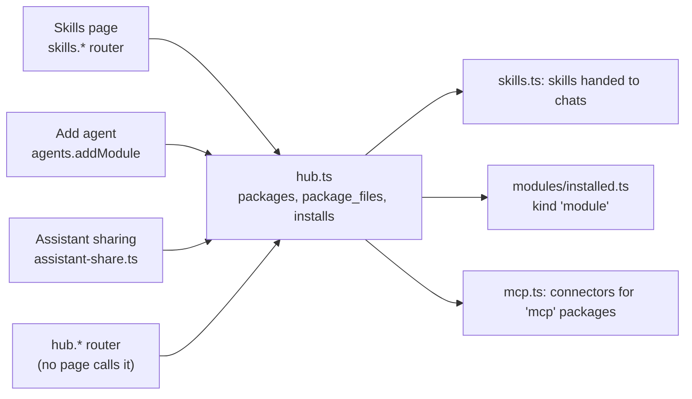

# Hub backend

The Hub is the package store behind Skills, Assistant sharing and agent modules. The Hub page itself (browse, import, review) moved to `old/web/src/components/Hub.tsx` and `HubReview.tsx` on 2026-10-27. The backend stayed, and the `hub.*` procedures are still mounted, but no console page calls them. Contract: `docs/HUB-API.md`.

Files: `src/server/hub.ts` (core), `src/server/hub-sources.ts` (GitLab and SkillsMP), `src/server/hub-guard.ts` (prompt-injection guard), `src/server/routers/hub.ts` (`hubRouter`, tRPC), `test/hub.test.ts`.

## Who uses it

- Skills page: `src/server/routers/skills.ts` stores a skill as a package of kind `skill`; `shareSkill` / `unshareSkill` publish it to the team. `src/server/skills.ts` reads them back with `skillIdsOf` and `skillContent`.
- Add agent (Settings, Agents & keys): `agents.addModule` creates and publishes a package of kind `module` and installs it when the caller may approve (`src/server/routers/agents.ts`, `docs/MODULES.md`).
- Assistant sharing: `src/server/assistant-share.ts` registers `reviewHooks.assistant`; a shared Assistant is a package of kind `assistant`.
- `src/server/routers/mentions.ts` lists `installedFor(userId).agents` for @-mentions.
- The `hub.*` router (list, import, registry, SkillsMP search, publish, approve, install) is mounted in `src/server/router.ts`, but only the tRPC client can reach it today.

## Wiring

- `ensureHubTables()` runs on import of `hub.ts` (idempotent): `packages`, `package_files`, `installs`.
- `hub.install` of an `mcp` package calls `upsertHubConnectors` (`removeHubConnectors` on uninstall) with `{name, url, transport, auth, source: 'hub:<packageId>'}` from `onMcpInstall`. Connectors holds the entry; sign-in happens there. The hub stores no credentials.
- `hub.install` of a `module` package calls `installModule` (`src/modules/installed.ts`) and needs `modules.manage`; there is no `installs` row, the `modules` table records it.
- `installedFor(userId)` is team installs then own. Skills and mcp entries from it are no longer mounted into a chat (the Flue `configurable.ts` that did so is in `old/`); skills reach CLI agents through `src/server/skills.ts`.

## Decisions

- Bundles embed their contents (all text files plus parsed skills, agents and mcp in the manifest); no child packages. Plugin `hooks/` and `commands/` go to `manifest.ignored`. Skills are found at any depth (SKILL.md dirs).
- Without `plugin.json`, an imported repo yields one package per skill, per `agents/*.md` and per remote MCP entry. With a `plugin.json` (or via a marketplace) it is one bundle.
- stdio MCP entries are only listed in `manifest.needsRunner`; a package with nothing installable returns 409 on install.
- MCP transport is `streamable-http` or `sse` (`http` accepted on input). Private and loopback URLs are rejected (`assertPublicUrl`).
- Versioning: same row. A changed content hash sends a published package back to `pending` (drafts stay drafts). `approved_json` holds the last approved snapshot (manifest and files); installs and views by anyone but the owner or a reviewer use only it. The owner's never-approved package installed for themselves (`me`) uses live content.
- `installedFor`: collisions are first wins, the rest skipped with an entry in `warnings`.
- Re-importing the same repo as the same user updates the existing package (same owner, kind, name).
- The guard runs per text file plus name and description (8 in parallel); if it fails, nothing is saved (502). It is the phrase heuristic in `hub-guard.ts`. Flagged packages are never auto-approved; a reviewer can approve explicitly. Test hook: `setGuard()`.
- GitHub import: `https://github.com/owner/repo[/tree/ref/path]` via the `codeload.github.com` tarball. Redirects are followed by hand and only to github.com or codeload.github.com. 30 s timeout, 50 MB download, 100 MB unpacked. Within the chosen subpath: at most 200 text files, 5 MB, depth 8; binaries are skipped; any symlink in the subpath rejects the import. Private repos are unsupported (no token). For a large repo, import a `/tree/ref/path` subfolder (the whole archive is still downloaded).
- GitLab import (`hub-sources.ts`): `https://<host>/<group…>/<project>[/-/tree/<ref>/<path>]` on gitlab.com or a self-hosted GitLab. The archive comes from `/api/v4/projects/<url-encoded path>/repository/archive.tar.gz` (`?sha=<ref>`; no ref means the default branch), then the same unpack, limits, subpath and symlink rules as GitHub. https only; the host must pass `assertPublicUrl` (hostname check only, no DNS pinning). Redirects stay on the same host; a sign-in redirect, 401, 403 or 404 reads as "private projects are not supported". Any non-github.com host is treated as GitLab.
- SkillsMP (`skillsmp.com`, free API `GET /api/v1/skills/search?q&page&limit`): `hub.skillsmpSearch` proxies it from the server (10 s timeout), keeps only results whose `githubUrl` is on github.com, and caches identical queries in memory for 10 minutes. Anonymous quota is 50 a day and 10 a minute per server IP; a 429 becomes "SkillsMP search limit reached for today. Paste a link instead." Optional env var `HEFYN_SKILLSMP_API_KEY` (account key, more quota). It is an env var because it is one optional operator value read by the web process only. A `skillsmp.com/skills/<slug>` page URL is resolved through the same search to its GitHub URL, then imported as GitHub (404 "could not find that skill" if it does not resolve).
- Egress: GitHub, GitLab, SkillsMP and the MCP Registry are fetched by the web process directly, not through the agent egress proxy, so `egress-list.ts` needs no entries.
- Created agents (`kind: 'agent'`: `name`, `description`, `instructions`, optional `model`, `thinking`, `skills`) are stored like an imported `agents/<name>.md` (frontmatter `name, description, model, thinking, skills`), private to the owner. `thinking` is one of `THINKING_LEVELS` (`src/server/agent-prefs.ts`).

## Untested / risks

- Registry: the shape was checked once against the live `/v0/servers` (`servers[].server.{name,description,repository,remotes[{type,url,headers}]}`); tests use a stub. Search is the registry's `search` param; import looks up the exact name within the first 50 results.
- No route-level tests of the tRPC router; permissions are enforced in `hub.ts` and tested there.
- Marketplace plugin sources: relative `./path`, `owner/repo`, `{source:'github'|'url'}` (GitHub only). Inline (`strict:false`) plugin definitions are not supported.
- The owner's display name reads Better Auth's `user` table (falls back to the id).
