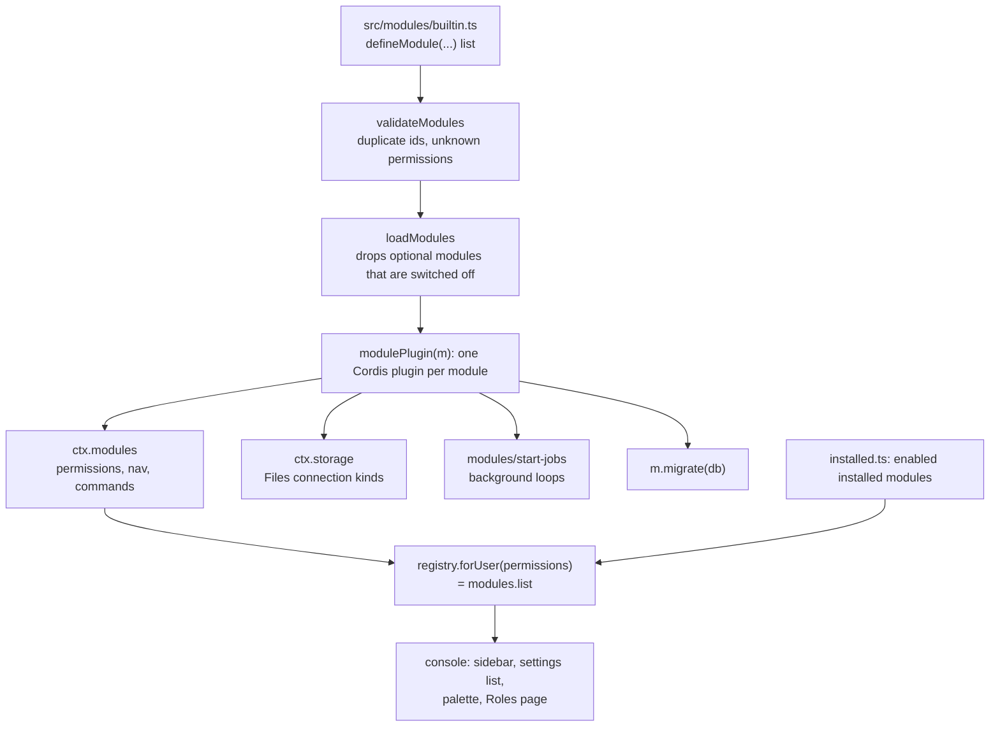

# hefyn — modules

hefyn is built from **modules**: a module adds nav entries, permissions, palette commands, routes, background jobs and so on through a fixed set of slots.
Each module is loaded as a plugin of the Cordis kernel (`src/kernel/index.ts`). There are two kinds, and they differ in where their code may run.

| | Built-in module | Installed module |
|---|---|---|
| Written by | the operator, in this repo (`src/modules/`) | anyone, as a manifest (`hefyn.module.json`) |
| Ships as | TypeScript, part of the build | a Hub package of kind `module`, through the Hub review flow |
| Server code | yes: Hono routes, jobs | **none** in hefyn's processes |
| Code it may run | anything in the server | only as a remote **MCP server** (HTTPS only) |
| Today | live | live for agent modules; the rest has no UI (see "Installed modules") |

Why the split: code inside the `web` process could read every user's data, so only code the operator reviewed and built may run there
(`docs/DESIGN.md`: "no user-uploaded server code").

The Modules page (install, enable, settings form) and the declarative screens (`/m/<id>/<screen>`) moved to `old/` on 2026-10-27 together with the other retired UI (note at the top of `docs/HARNESS.md`).

## Kernel



- `src/modules/registry.ts` builds the kernel, calls `bootCheck` (a plugin that failed or waits for a missing service stops the boot with its name) and exposes `forUser(held)`, which is what `modules.list` returns (`src/server/routers/modules.ts`). The console builds its nav, settings list, palette and Roles page from it, only with entries the user may use.
- Disabling a module means not loading it; disposing the plugin removes what it added (permissions, nav, storage kinds, job timers).
- `startJobs()` runs once in the web process (`src/web.ts`).
- `src/modules/active.ts` holds the loaded list for core code; `forgetInAll` reaches every module, also a switched-off one, when a user or chat is deleted.
- The console side is `web/src/modules/registry.ts` (sidebar sections, chat badges, palette entries, slash commands); a web module appears only when the server lists the module. Today the only one is `web/src/modules/folders`.

## Slots of a built-in module

`defineModule` takes (`src/modules/types.ts`), all optional except `id` and `name`:

- `description`, `icon` (lucide name).
- `optional`: can be switched off with `HEFYN_MODULES_DISABLED=id,id` or the instance setting `modules_disabled` (read at boot). A disabled module registers nothing. No built-in module is optional today.
- `permissions`: `{id, label, hint, group, worker}`; `worker: true` grants it to the Worker role once, when the module first appears. Admin always holds every permission.
- `nav` (`place: 'main' | 'settings'`; settings entries have `group: 'you' | 'workspace'`), `commands` (⌘K palette), each with an optional `permission` (one or a list; any of them) and `order`.
- `routes`: Hono apps mounted under `/api`.
- `migrate(db)`: idempotent, runs at boot in every process that loads the module.
- `sealed`: the module's sealed columns (user key or team key), so key rotation and "start fresh" reach them.
- `onConversationDelete`, `onUserDelete`.
- `conversation`: `create`, `list`, `patch`, `bulk` hooks into the conversations API (folders use them).
- `storageProviders`: kinds of Files connection. Each is `{ kind, label, fields, connect(config, secrets, ctx) -> Adapter }` (`src/server/connections/types.ts`); the plugin registers them with `ctx.storage` while the module is loaded, and the `connections` API and the sync engine (`docs/STORAGE.md`, "Connections") use whatever is registered. Installed modules run no server code, so third parties add a kind by running a remote MCP server and using the built-in `mcp` kind.
- `jobs`: `{name, everyMs, first?, init?, run}`; a failing run is logged and the loop goes on.

Built-in modules today (`src/modules/builtin.ts`, `connections.ts`, `folders/`, `agents/`): models, users, roles, usage, hub (Skills nav), files (Sandbox; the Files page and `/api/files`), connections (Files connections kinds and the sync job), folders, connectors, channels (Mail; permission only, the page moved), modules (permission only), security, agent-accounts, devices, app-passwords (Connected apps), appearance, profile, branding. Models, users, roles and usage keep their routes in `api.ts` and the tRPC routers; the module only declares permissions, nav and commands. The `models` module also runs the agent-update job.

The earlier slots `screens`, `settings`, `skills`/`agents`, `mcp`, `agent` (tools for the chat agent) and `tools` belong to the Flue chat and the declarative modules; they are not in `HefynModule` any more. The projects and schedules modules are in `old/src/modules/`.

## Installed modules

An installed module is a manifest (`src/modules/manifest.ts`, strict: unknown keys are errors, each error names its path) that a Hub package of kind `module` carries. The Hub screens it like any package (guard, review). `hub.install` on it (permission `modules.manage`) calls `installModule` (`src/modules/installed.ts`), which in one transaction writes the `modules` row, registers the module's permissions (ids `mod.<id>.<name>`), nav and commands, installs its `skills` and `agents` for the team, and creates the `mcp` connector. Disable and uninstall reverse it.

**What is reachable today.** The manifest, the install and the Hub kind still exist in code, but the Modules page is gone and no route serves settings, screens or `callTool`. So the only installed modules in use are **agent modules** (below), which the Agents page adds. The following code is kept but has no caller: `screenFor`, `getSettings`/`putSettings`, `callTool`, `src/modules/screen-schema.ts`, `src/modules/mount.ts`.

**Dormant screens and tool calls** (reconnect behind a route before relying on them). A screen is JSON (a title, a hint, blocks `text | alert | stat | table | list | form | button`) validated with valibot on install and before rendering; no HTML, no `href` other than `https:` and the module's own `/m/` paths. Data comes from `tools/call` on the module's MCP server, made by `web` for the user, with these limits (`src/modules/installed.ts`): HTTPS only, no redirects, URL refused when the host is loopback, private, link-local, CGNAT, multicast or reserved, a bare service name or `localhost`/`*.internal`/`*.local`; 20 s timeout; 64 KB request and 1 MB result caps. There is no DNS pinning, and hefyn sends no header saying which user is calling. Module settings travel as `x-hefyn-setting-<key>` headers (secrets unsealed for that request only).

## Agent modules

A CLI coding agent (Claude Code, Codex, OpenCode, Pi ...) is added to hefyn by a **declarative agent manifest**: JSON, no code, never executed by hefyn
(it is only read and filled in, `src/cli-agents/manifest-profile.ts`). The four built-in agents are exactly such manifests (`src/modules/agents/*.json`).
Agents that have no module are not listed anywhere: there is no "not supported yet" list.

**Adding one.** (a) As a Hub package of kind `module` whose manifest is an agent manifest (`hub.create`; it goes through the normal
review, and an admin with `modules.manage` installs it; on install it is a row of the `modules` table with the agent section in `cliAgent`). (b) By an
admin (`models.manage`) pasting or uploading it under Settings → Agents & keys → Add agent (`agents.addModule`): same validation, and it goes through
the Hub (create + publish), so an approver's module is live at once and anyone else's waits in the review queue. A module also fits in a larger
manifest: the same fields, without `kind`, as `cliAgent` of a module manifest. Either way the catalog updates at once, in every process, without a
restart (`profileOf` reads the enabled modules on each call). Then **Install** works as for a built-in agent. **Removing** (`agents.removeModule`, after
a confirmation in the UI) stops new chats on the agent, uninstalls it from the volume, and removes the module. Uninstalling or disabling the module
(`hub.uninstall`) also makes the agent unavailable (its install row goes; the files stay in the volume until it is removed on the Agents page).
A module cannot reuse the id of a built-in agent.

**Manifest** (strict: unknown keys are errors; every error names the path and the reason):

| Key | Meaning |
|---|---|
| `kind` | `"agent"` (what tells it from a module manifest) |
| `id`, `name`, `description`, `version?` | 2-32 chars `a-z0-9-` (the directory in the agents volume), shown name, one plain line, optional version of the module |
| `icon?`, `license?`, `licenseUrl?` | public `https` image / licence text and link, shown in the catalog |
| `distribution` | `{registry: "<ACP id>"}` (version, icon and licence from the ACP Registry), or `{version, npm: "pkg@1.2.3"}` (exact pin), or `{version, binary: {"linux-x86_64"\|"linux-aarch64": {archive: https, sha256}}}`. Same checks as the runner's installer: pinned packages, https archives without credentials, mandatory sha256 |
| `api` | `"anthropic"` or `"openai-responses"`: which gateway front the agent speaks to |
| `asksBeforeActing` | `true`/`false`. `false` shows the "acts without asking" warning and needs a confirmation to install or enable |
| `launch` | `{npm: {package, bin, extra?: ["dep@1.2.3"], check?: ["node_modules/.bin/x"]}}` (the ACP server is `node_modules/.bin/<bin>`) or `{binary: {cmd: "./name", args?}}`, or `{wrapper: {adapter: "claude-code", npm: {package, extra?, check?}}}`: the agent's own CLI in a PTY, the chat built from its hooks and transcript instead of ACP (docs/WRAPPER.md; `terminal.command` is the launch script and may use `{{sessionId}}`; only the `claude-code` adapter exists) |
| `terminal` | `{command, resume?: {sessionId: "uuid"\|"opencode", command}}`: the shell script of the terminal view; `resume.command` is used instead when the conversation has a session id of that shape |
| `env` | `{NAME: template}`: the agent's environment |
| `config` | `{dir, instructionsFile, skillsDir, mcpConfig}`: where the agent keeps its config (`dir`, `skillsDir` under `/tmp`), the file hefyn writes an Assistant's instructions to, the skills directory, and a note where MCP servers go |
| `files` | `[{path, format, content, force?, indent?, when?}]` written before the agent starts. `format`: `json-merge` (merged into what is there; `force` true: ours wins, else what is there wins), `json` (replaced; `indent`), `text` (replaced; `content` is a list of lines; TOML and the like). `when: "assistant"`: only when the conversation runs an Assistant |
| `providers` | `[{api, files?}]`, optional: which model providers the agent can run on, by the wire API it speaks to them: `anthropic` (Messages), `openai-responses`, `openai-chat` (chat completions: OpenRouter, Mistral, Groq, DeepSeek, xAI, OpenAI itself, a custom OpenAI-compatible endpoint). Must list `api` (the default). `files` of the entry are written after the common `files` when the session's provider is served by that API (same format as `files`, with `{{provider.id}}` and `{{assistant.model}}`; JSON keys may be templates, an object in a list with an unmet `$when` is left out). Which provider a session runs on is the Assistant's choice (its Agent, Provider and Model) or the admin's default for the agent; the gateway takes the upstream from that, never from the request. Without `providers` the agent runs on `api` only (Claude Code: Anthropic; Codex: OpenAI). Built in: OpenCode `anthropic` + `openai-chat`, Pi `anthropic` + `openai-chat` |

**Placeholders** (`{{name}}`, nothing else; a filter `|json` quotes a value inside a `text` file):

| Placeholder | Where | Value |
|---|---|---|
| `{{gatewayBase}}` | env, files | the sandbox's model bridge, `http://127.0.0.1:<port>` |
| `{{dummyKey}}` | env, files | the placeholder key (the real key never enters the sandbox) |
| `{{installDir}}` | env, terminal | `/opt/agents/<id>/<version>` |
| `{{shim.<file>}}` | env, files | `/opt/hefyn/<file>`, only files shipped in the sandbox image (`SHIMS` in `src/modules/agent-manifest.ts`; today `codex-shim.mjs`) |
| `{{theme}}` | files | `light` or `dark`, when the browser sent it |
| `{{assistant.model}}` | files | the Assistant's model id, if any |
| `{{provider.id}}` | files (also as a JSON key) | the model provider the session runs on (`anthropic`, `openai`, `openrouter`, `mistral`, `custom` ...); always has a value. In a `text` file write `{{provider.id\|json}}` |
| `{{sessionId}}` | `terminal.resume.command` | the conversation's session id, shell-safe by its declared shape |

A JSON key whose string has a placeholder with no value (no theme, no Assistant model) is left out; a `text` line is left out likewise. An object with
`"$when": "assistant.model"` (or `"theme"`) is `{}` unless that value exists. `{{assistant.instructions}}` does not exist: instructions and skills are
written to `config.instructionsFile` and `config.skillsDir` by hefyn (they are too big for the launch environment).

**What is refused:** unknown keys, placeholders or filters; paths outside `/tmp` (or outside `config.dir` for `files`), `..`; any `://` or `www.` in a
template (model traffic goes to `{{gatewayBase}}` only); an env var named like a URL, host, endpoint, proxy or base (`*URL*`, `*HOST*`, `*BASE*` ...)
unless its value is `{{gatewayBase}}` (+ a path); an env var named like a key, token, secret or password unless its value is `{{dummyKey}}`; `PATH`,
`NODE_OPTIONS`, `LD_*`, `HEFYN_SEED` and other variables that change how the sandbox starts; shims that are not in the image; unpinned packages and
missing checksums. The sandbox has no network at all, so this is the second wall; the gateway remains the first.

```json
{
  "kind": "agent", "id": "acme-agent", "name": "Acme Agent", "description": "Acme's coding agent.",
  "distribution": { "version": "1.2.3", "npm": "acme-acp@1.2.3" },
  "api": "anthropic", "asksBeforeActing": true,
  "launch": { "npm": { "package": "acme-acp", "bin": "acme-acp" } },
  "terminal": { "command": "exec {{installDir}}/node_modules/.bin/acme" },
  "env": { "ACME_HOME": "/tmp/.acme", "ANTHROPIC_BASE_URL": "{{gatewayBase}}", "ANTHROPIC_API_KEY": "{{dummyKey}}" },
  "config": { "dir": "/tmp/.acme", "instructionsFile": "AGENTS.md", "skillsDir": "/tmp/.acme/skills", "mcpConfig": "/tmp/.acme/mcp.json" },
  "files": [
    { "path": "/tmp/.acme/settings.json", "format": "json", "when": "assistant", "content": { "$when": "assistant.model", "model": "{{assistant.model}}" } }
  ]
}
```

Tests: `test/agent-modules.test.ts` (validation, the four built-in manifests against `test/fixtures/agent-profiles.snapshot.json`, Hub package -> review ->
catalog -> install -> remove), `test/modules.test.ts`, `test/module-contract.test.ts`, `test/kernel.test.ts`.

## Writing a module

**Built-in.** Add a `defineModule({...})` entry to the list in `src/modules/builtin.ts` (or a file imported there, as `connections.ts` and `folders/index.ts`):

```ts
defineModule({
  id: 'notes', name: 'Notes', icon: 'StickyNote',
  permissions: [{ id: 'notes.use', label: 'Use notes', group: 'Notes' }],
  nav: [{ place: 'main', label: 'Notes', href: '/notes', icon: 'StickyNote', permission: 'notes.use', order: 60 }],
  routes: [{ path: '/notes', app: notesRoutes }], // a Hono app, mounted under /api; guard it with requireAuth
}),
```

A page for it is a component in `web/src/components/` plus an entry in `pages` of `web/src/entry.tsx`. Routes are code, so they are reviewed and built with the app.

**Agent module.** Copy the JSON example above and add it under Settings → Agents & keys → Add agent.

**Declarative module.** [`examples/hello-module.json`](examples/hello-module.json) shows the format; its screens and settings are dormant (see "Installed modules"), so it only installs its permissions, nav, skills, agents and MCP connector, and nothing in the console installs it.
