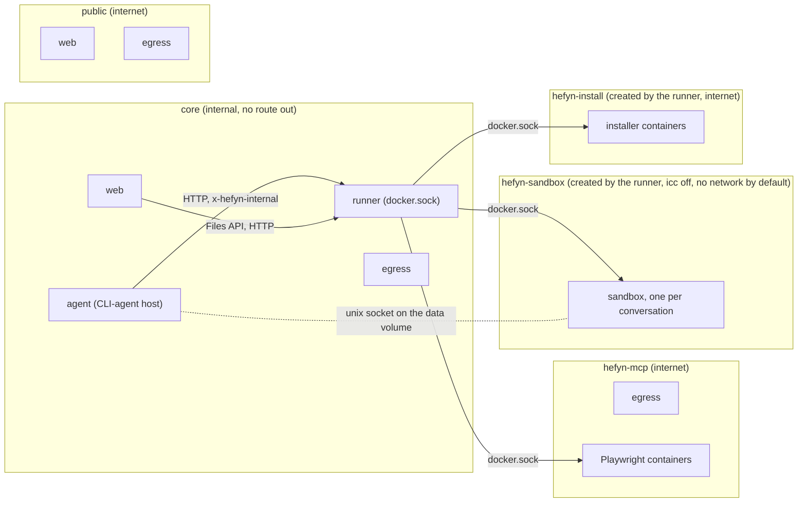
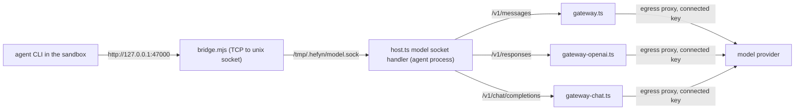

# Sandbox, runner and hosted CLI agents

Every chat in hefyn runs a coding agent (Claude Code, Codex, OpenCode, Pi or an agent module) inside a per-conversation
Docker container, the **sandbox**. The sandbox image and the runner are therefore **required**, not optional: without
`HEFYN_RUNNER_URL` (and the image) a user gets "This hefyn has no sandbox set up yet" and cannot start a chat.

Code:

- `services/runner/` (`src/server.ts`, `docker.ts`, `logic.ts`): the **runner**, the only service that holds `docker.sock`.
- `services/sandbox-image/` (`Dockerfile`, `bridge.mjs`, `run-agent.sh`, `seed.mjs`, `install-agent.mjs`, `codex-shim.mjs`, `managed-settings.json`): the sandbox image.
- `src/cli-agents/`: the CLI-agent host. `host.ts` drives the sessions, `attach.ts` is the client of the runner's attach endpoint, `profiles.ts` / `manifest-profile.ts` describe each agent, `gateway*.ts` are the model gateways, `installed.ts` / `registry.ts` handle installs.
- `src/server/container-fs.ts`: file and command access to a sandbox through the runner's exec (seeds, Files API, sign-in checks). `src/server/runner.ts`: which users get a container and the Files API on top of it.

## Layout

`web`, `egress` appear in two or three networks in `docker-compose.yml`; the drawing repeats them per network. The agent
process is on `core` only; its way out is the egress proxy. Sandboxes are not on any compose network, so web, agent,
egress and runner are unreachable from them.

The model path (no network needed in the sandbox):

## Runner API (`services/runner`, port 8790, internal network only)

Every request, including `/health`, needs `x-hefyn-internal: $HEFYN_INTERNAL_TOKEN` (timing-safe; 401 otherwise). Ids are
`[A-Za-z0-9_-]{1,128}`. The container id returned is `sha256(userId \0 conversationId)[:16]`; callers never name containers.

| Call | Result |
|---|---|
| `GET /health` | `{ok:true}` (checks the Docker daemon) |
| `POST /sandboxes {userId, conversationId}` | `{id}`; idempotent, one container per conversation |
| `POST /sandboxes/:id/exec {cmd, cwd?, env?, timeoutMs?, stdin?, maxOutput?}` | `{stdout, stderr, exitCode, truncated, timedOut}`. `cmd` is a string (run by `bash -c`) or an argv array. `cwd` must be inside `/files` or `/tmp`. `stdin` is base64. Output is capped per stream (default 1 MB, request may raise it to 64 MB), timeout default 120 s, max 10 min (kill via `timeout -k 2s`, hard socket kill 5 s later). Client disconnect cancels the stream |
| `DELETE /sandboxes/:id` | removes the container (files stay on the volume) |
| `POST /sandboxes/:id/attach?spec=<json>` (HTTP Upgrade) | 101 + raw stream, see "Attach" |
| `POST /sandboxes/:id/attach/:execId/resize {cols, rows}` | `{ok:true}`; only for an exec this runner started as an attach of that sandbox (404 otherwise) |
| `POST /mcp/playwright {userId, conversationId}` | `{id, url}` with `url = http://hefyn-pw-<id>:8931/mcp` |
| `DELETE /mcp/playwright/:id` | removes it |
| `POST /agents/install`, `GET /agents/:id/:version`, `POST /agents/:id/:version/json`, `DELETE /agents/:id/:version` | agent installs, see "Agents from the ACP Registry" |

Idle reaper (every 60 s, containers with a running exec are never reaped), per-user and global caps (HTTP 429), JSON logs
(commands, stdin and output are never logged), graceful shutdown. On restart the runner re-adopts running containers with a fresh idle clock.

### Environment

| Var | Default | |
|---|---|---|
| `HEFYN_INTERNAL_TOKEN` | required | shared with web/agent |
| `HEFYN_DATA_DIR` | `/data` | where the runner sees the data volume |
| `HEFYN_RUNNER_HOST_DATA_DIR` | unset | bind mode (local runs): host path of the data dir. Unset: the runner inspects its own container and mounts the same named volume into sandboxes with **`VolumeOptions.Subpath`** (needs Docker Engine >= 26) |
| `HEFYN_SANDBOX_IMAGE` / `HEFYN_PLAYWRIGHT_IMAGE` | `hefyn-sandbox` / `mcr.microsoft.com/playwright/mcp` pinned by digest in `logic.ts` | operator-set only |
| `HEFYN_SANDBOX_EGRESS` | `none` | `none` or `internet`, see "Network" |
| `HEFYN_SANDBOX_NETWORK` / `HEFYN_MCP_NETWORK` | `hefyn-sandbox` / `hefyn-mcp` | created if missing |
| `HEFYN_SANDBOX_UID` | 1000 | |
| `HEFYN_SANDBOX_PIDS` / `_MEMORY_MB` / `_CPUS` | 256 / 1024 / 1 | `HEFYN_PLAYWRIGHT_MEMORY_MB` 2048 |
| `HEFYN_RUNNER_IDLE_MINUTES` | 5 | a sandbox with no exec and no attached process is stopped after this; the host closes an idle chat's agent after 10 minutes. At the per-user cap the least recently used idle sandbox is stopped instead of refusing (one with a running exec or attach never) |
| `HEFYN_RUNNER_MAX_SANDBOXES_PER_USER` | code default 2 (`logic.ts`); **`docker-compose.yml` sets 8** (`${HEFYN_RUNNER_MAX_SANDBOXES_PER_USER:-8}`: one per active conversation + the Files API container) | per user |
| `HEFYN_RUNNER_MAX_SANDBOXES` | 20 | all users |
| `HEFYN_RUNNER_MAX_PLAYWRIGHT_PER_USER` / `HEFYN_RUNNER_MAX_PLAYWRIGHT` | 1 / 5 | |
| `HEFYN_RUNNER_OUTPUT_BYTES`, `_MAX_OUTPUT_BYTES`, `_MAX_TIMEOUT_MS`, `_MAX_BODY_BYTES` | 1 MB, 64 MB, 600000, 96 MB | |
| `HEFYN_RUNNER_MAX_ATTACH` / `HEFYN_RUNNER_ATTACH_GRACE_MS` | 4 / 5000 | see "Attach" |
| `HEFYN_AGENTS_DIR` | `/agents` | where the runner sees the `hefyn-agents` volume (read-only) |
| `HEFYN_INSTALL_NETWORK` / `HEFYN_INSTALL_MEMORY_MB` / `HEFYN_INSTALL_TIMEOUT_MINUTES` / `HEFYN_RUNNER_MAX_INSTALLS` | `hefyn-install` / 2048 / 10 / 2 | agent installer containers ("Agents from the ACP Registry") |

`web` and `agent` get `HEFYN_RUNNER_URL=http://runner:8790` in compose.

## Attach (`POST /sandboxes/:id/attach`, long-lived processes)

For hosted CLI agents: the agent over stdio (ACP, `tty:false`) or its own TUI (`tty:true`). An HTTP Upgrade like Docker's own hijack. The client is `src/cli-agents/attach.ts` (`runnerAttach`), which uses a raw socket because Bun's `http` client never emits `upgrade`; the Docker-side hijack is `docker.hijack` in `services/runner/src/docker.ts`; the server side is `server.on('upgrade', runner.upgrade)`.

- Request: `POST /sandboxes/:id/attach?spec=<url-encoded JSON>` with `Connection: Upgrade`, `Upgrade: tcp`, `x-hefyn-internal`, no body (the spec is in the query so every byte after the headers is stdin). `spec = {cmd, tty, cwd?, env?, cols?, rows?}`: `cmd`, `cwd`, `env` follow the exec rules (argv array or a string for `bash -c`; cwd inside `/files` or `/tmp`; env names checked); `tty` is required; `cols`/`rows` 1-1000 (default 80x24; the initial size is part of the exec).
- Answer: errors are plain JSON (401/400/404/429) before any upgrade. Success is `101` with `X-Hefyn-Exec-Id: <id>` (use it for resize), then bytes both ways. `tty:true`: raw both ways. `tty:false`: Docker's 8-byte-header stream is demultiplexed, only stdout reaches the caller, stderr lines go to the runner log (`attach stderr`, at most 50 lines of 500 characters per attach; the only place the runner logs process output).
- Lifecycle: no timeout, no output cap. An open attach counts as busy (the idle reaper skips the sandbox) and as one of at most `HEFYN_RUNNER_MAX_ATTACH` (default 4) per sandbox (429). When the process ends, the stream is closed. When the caller closes the connection first, the process is killed: Docker has no exec kill, so every attach runs with a private `HEFYN_ATTACH=<random>` environment marker and a second exec kills every process carrying it (the descendants inherit it). A caller that only half-closes (FIN) has sent stdin EOF; a FIN is also what a destroyed client looks like, so the process gets `HEFYN_RUNNER_ATTACH_GRACE_MS` (5000) to end by itself and is then killed. For a terminal a FIN is a hangup and kills at once. The `run-agent.sh` bridge is started without the marker so it survives the close of one attach.
- Tests: the attach path runs in the real-Docker tests `test/cli-agent-wrapper.test.ts` and `test/cli-agent-install.test.ts` (stack in `test/cli-agent-stack.ts`) and against fakes in `test/cli-host.test.ts`, `test/cli-wrapper-host.test.ts`, `test/sandbox-room.test.ts`. Cap and eviction logic: `test/runner-evict.test.ts`.

## What a sandbox container is

Fixed image `hefyn-sandbox` (Debian bookworm slim: bash, coreutils, findutils, git, curl, ca-certificates, ripgrep, jq,
python3 + venv + pip), Node 22 (copied from `node:22-bookworm-slim`: Debian's own nodejs is too old for several agents) with npm, and `/opt/hefyn/{bridge.mjs,run-agent.sh,seed.mjs,install-agent.mjs,codex-shim.mjs}` plus the managed settings (see "Hosted CLI agents"). No agent is baked in: they come from the ACP Registry (below). User `hefyn`, uid/gid 1000, cwd `/files`.

Mounts, all chosen by the runner (paths under the data volume):

| In the sandbox | From | Mode |
|---|---|---|
| `/files` | `users/<id>/files` | rw |
| `/tmp` | `users/<id>/tmp/<conv>` | rw (agent config, transcripts, `.hefyn/*.sock`) |
| `/claude-home` | `users/<id>/claude-home` | rw; the user's own Claude Code home, only ever that user's |
| `/accounts` | `users/<id>/accounts` | rw; the user's own account homes of every agent |
| `/team-accounts/<agent>` | `team-accounts/<agent>` | rw; only for agents whose team login hefyn says this user may use |
| `/opt/agents` | the `hefyn-agents` volume | **read-only** |

Hardening, all fixed by the runner: `CapDrop ALL`, `no-new-privileges`, read-only rootfs (tmpfs `/run` 16 MB,
`/home/hefyn` 64 MB), pids 256, memory 1 GB (swap = memory), 1 CPU, init process, not privileged, no docker socket, no
other mounts, own bridge network `hefyn-sandbox` with **inter-container communication disabled** (sandboxes cannot reach each other)
and not attached to the compose networks.

A sandbox that lacks `/claude-home`, `/accounts`, `/opt/agents` (when the volume exists) or has a different set of team homes than allowed now is replaced by the runner on its next use; its `/files` and `/tmp` stay.

Besides the per-conversation sandboxes, a user with `sandbox.shell` has one `files` container (conversation id `files`) behind the Files API, see "Who gets a sandbox".

**Volume ownership.** The runner (plain TypeScript on `oven/bun:1.4.4`, no dependencies, `bun src/server.ts`) runs as root, so the volume is root-owned. On container creation the runner creates the user's directories and `chown`s each directory level it creates to uid 1000 (no recursive walk; it falls back to `chmod 777` of that directory, logged as warn, if the chown fails, e.g. local runs as non-root). The web and agent images run as uid/gid 1000 (`Dockerfile`: `USER 1000:1000`; `/data` is created owned by 1000, so new volumes inherit it), so files they write are writable from the sandbox. A volume created before that is root-owned: `chown -R 1000:1000` it once. Sandbox mounts use `NoCopy`: without it Docker copies the image's root-owned `/files` over the user's dir on first start. The runner container keeps `CHOWN`, `FOWNER` and `DAC_OVERRIDE` after `cap_drop: ALL`.

### Network

Every sandbox is always attached to the Docker bridge network named by `HEFYN_SANDBOX_NETWORK` (`hefyn-sandbox`), never to Docker's own `none` network (`NetworkMode` is that network in `server.ts`). `ensureNetwork` creates it with inter-container traffic off (`enable_icc=false`); `logic.ts` reads `HEFYN_SANDBOX_EGRESS` and anything but the exact word `internet` means `none`.

- **Default, `HEFYN_SANDBOX_EGRESS=none`**: the network is created with `Internal: true`. The sandbox has an interface and an address on it, but Docker gives it no route out: no internet, no host, no other compose service, and no other sandbox. Open internet would let a prompt-injected model send the files out. Model traffic still works because it leaves through the unix socket on the data volume, not the network.
- **`HEFYN_SANDBOX_EGRESS=internet`** (needed for git, npm, pip inside a chat): the network is created with `Internal: false`, an ordinary bridge with NAT to the internet (still no sandbox-to-sandbox traffic). Exfiltration of anything in `/files` is then possible by design. On a real server run `scripts/sandbox-egress-rules.sh` (DOCKER-USER rules: RFC1918, link-local and cloud metadata 169.254/16, CGNAT, loopback, host INPUT; run it after the first sandbox exists, and again if the network is recreated). A package-registry allowlist through the egress proxy is not built; the choice is all or nothing.
- Switching: an older open `hefyn-sandbox` network is replaced by an internal one when the setting is `none` (sandboxes running on it are removed). The other direction needs `docker network rm hefyn-sandbox` first.
- The runner creates `hefyn-sandbox` and `hefyn-install` itself (inter-container traffic off), deliberately outside compose. `hefyn-mcp` is declared in compose with a fixed name; the runner creates it if missing (inter-container traffic on).

## Hosted CLI agents in the image

`/opt/hefyn/run-agent.sh <cmd...>` is generic: it starts `bridge.mjs` once per container (a Node built-ins-only TCP-to-unix-socket pipe: `127.0.0.1:${HEFYN_BRIDGE_PORT:-47000}` -> `${HEFYN_MODEL_SOCKET:-/tmp/.hefyn/model.sock}`; a second pipe `127.0.0.1:${HEFYN_AUTH_PORT:-47001}` -> `/tmp/.hefyn/auth.sock` exists for own-account sign-in, see below), has `seed.mjs` write the config files the host passes in `HEFYN_SEED` (a JSON list: `{path, text}` replaces a file, `{path, json, force}` deep-merges into it, the seed winning only when forced; paths only under `/tmp`), then execs the command. Everything agent-specific (environment, seeds, launch command, terminal command) comes from the agent's **profile** (`src/cli-agents/profiles.ts`) through the attach spec's `env`. Hefyn listens on the socket at `<DATA_DIR>/users/<id>/tmp/<conv>/.hefyn/model.sock` and serves the fronts on it by path (`src/cli-agents/host.ts`): `/v1/messages` is the Anthropic Messages front (`gateway.ts`), `/v1/responses` the OpenAI Responses front (`gateway-openai.ts`), `/v1/chat/completions` the OpenAI-compatible front (`gateway-chat.ts`, below). They forward the request with the connected key and refuse OAuth credentials. Managed settings in `/etc/claude-code/managed-settings.json` (in the image, root-owned) carry Claude Code's http hooks to `127.0.0.1:47000/hooks/<event>` (`allowedHttpHookUrls` allows only that), and deny `WebSearch` (a server tool the gateway refuses) and `WebFetch` for Claude Code. `seed.mjs` also writes under `/claude-home` (Claude Code's config dir on the user's own account).

The socket needs the agent process and the sandbox to see the same filesystem **inside Docker**: a unix socket created on the host does not cross a Docker Desktop (macOS) bind mount (`connect` fails with `ENOTSUP`), but works when both sides are containers on the named data volume (the compose stack, dev or production). Run hosted CLI agents from the compose stack on macOS, not from `bun run` on the host. The host binds through a short symlink because `sun_path` is ~104 bytes.

### Agent profiles (agent modules)

An agent is available only if it has an **agent module** (docs/MODULES.md "Agent modules"): a declarative manifest, never executed, that routes **all** its model traffic through the gateway. The four below ship as manifests in `src/modules/agents/*.json` (`profiles.ts` turns each into the profile the host uses, `manifest-profile.ts`); others are added as Hub packages or pasted by an admin and appear without a restart. The ACP Registry is only the source of distributions, versions and icons for modules that name a registry id. Keyed by agent id (the ACP Registry id for these); config keys below were checked against the versions named (2026-10-26) by running the real binaries against a recording stand-in.

| Registry id | Agent | Front | Launch (chat) | Terminal | Config seeded (under `/tmp`) |
|---|---|---|---|---|---|
| `claude-acp` (id kept; `@anthropic-ai/claude-code` 2.1.310, the platform binary `@anthropic-ai/claude-code-linux-<cpu>/claude`, no scripts run) | Claude Code | anthropic | **no ACP**: one PTY, `--session-id <uuid>` or `--resume <uuid>`; the chat is built from hooks and transcript (docs/WRAPPER.md) | the same PTY | env `ANTHROPIC_BASE_URL=http://127.0.0.1:47000`, `ANTHROPIC_API_KEY=hefyn-gateway`, `CLAUDE_CONFIG_DIR=/tmp/.claude`, `DISABLE_AUTOUPDATER`, `DISABLE_INSTALLATION_CHECKS`, `CLAUDE_CODE_DISABLE_NONESSENTIAL_TRAFFIC`, `DISABLE_TELEMETRY`, `DISABLE_ERROR_REPORTING`; `/tmp/.claude/.claude.json`: onboarding done, dummy key approved, `/files` trusted, theme, `hasSeenAutoDefaultNudge`; `/tmp/.claude/settings.json`: `permissions.defaultMode: "default"` (own account: the same under `/claude-home`, without base URL and key, with `HTTPS_PROXY`) |
| `codex-acp` 2.2.2 | Codex (`@openai/codex` 0.160.1, platform binary `@openai/codex-linux-<cpu>`) | openai-responses | `node_modules/.bin/codex-acp` | `codex` (`codex resume <id>` if its rollout exists) | `CODEX_HOME=/tmp/.codex`; `/tmp/.codex/config.toml`: `model_provider = "hefyn"`, `[model_providers.hefyn] base_url = "http://127.0.0.1:47000/v1"`, `wire_api = "responses"`, `env_key = "HEFYN_GATEWAY_KEY"`, `requires_openai_auth = false`, `web_search = "disabled"`, `check_for_update_on_startup = false`, `sandbox_mode = "danger-full-access"` (the container is the sandbox; codex's own sandbox cannot start in it), approvals as below, analytics and feedback off |
| `opencode` 1.19.4 | OpenCode (one Go/Bun binary, `./opencode acp`) | anthropic | `<dir>/opencode acp` | `opencode [--session <ses_...>]` | `XDG_*` under `/tmp`, `OPENCODE_DISABLE_AUTOUPDATE`, `OPENCODE_DISABLE_MODELS_FETCH`; `/tmp/.config/opencode/opencode.json`: `provider.anthropic.options.baseURL = "http://127.0.0.1:47000/v1"`, `autoupdate: false`, `share: "disabled"`, `enabled_providers: ["anthropic"]`, `permission.webfetch: "deny"` |
| `pi-acp` 0.0.34 | Pi (`@earendil-works/pi-coding-agent` 1.4.0, which pi-acp needs but does not depend on: the profile installs it next to it) | anthropic | `node_modules/.bin/pi-acp` (`PI_ACP_PI_COMMAND` points at the installed `pi`) | `pi --continue` | `PI_CODING_AGENT_DIR=/tmp/.pi/agent`, `PI_OFFLINE=1`, `PI_SKIP_VERSION_CHECK=1`, `PI_TELEMETRY=0`; `/tmp/.pi/agent/models.json`: `providers.anthropic.baseUrl = "http://127.0.0.1:47000"` |

Each profile also records where instructions (`CLAUDE.md` / `AGENTS.md`), skills and MCP servers live, for the Assistants: Claude `/tmp/.claude/{CLAUDE.md,skills/}` and MCP in `.claude.json`; Codex `/tmp/.codex/{AGENTS.md,skills/}` and `[mcp_servers.*]` in `config.toml`; OpenCode `/tmp/.config/opencode/{AGENTS.md,skills/}` and `mcp` in `opencode.json`; Pi `/tmp/.pi/agent/{AGENTS.md,skills/,mcp.json}`.

**Asking before acting** (verified with stand-ins, `test/cli-agent-codex.test.ts`, `test/cli-agent-opencode.test.ts`): Claude Code asks via its permission hook. OpenCode's default allows edits and commands, so the profile sets `permission: {edit: "ask", bash: "ask", webfetch: "deny"}`; each edit and command is then an ACP permission request. Codex (0.160.1): codex-acp's session modes (read-only, workspace-write, agent, agent-full-access) override `config.toml` on every turn, none is "untrusted", and every one with a sandbox needs bubblewrap, which the hardened container cannot start (every command failed and escalated: a prompt even for `ls`). So `CODEX_PATH=/opt/hefyn/codex-shim.mjs` starts the real codex (`CODEX_REAL`) and sets `approvalPolicy: "untrusted"`, `sandboxPolicy: dangerFullAccess` on each `turn/start` (the container is the sandbox). In 0.160.1 "untrusted" no longer has a built-in safe list: it asks for everything no exec-policy rule allows, so the profile seeds `/tmp/.codex/rules/default.rules` allowing `ls cat head tail pwd wc grep` (only commands that cannot start another program: rules match prefixes, so `rg --pre CMD` or `find -exec` would run anything unasked and are left out). Edits (`apply_patch`), `rm`, `curl`, `touch`, redirects ask as ACP permission requests; a rejection ends the turn (`cancelled`) and changes nothing. The terminal UI cannot say "untrusted" (config refuses it, "no longer supported"), so `config.toml` uses `approval_policy = { granular = { sandbox_approval = true, rules = true, mcp_elicitations = true } }` with `sandbox_mode = "danger-full-access"`, which asks for the same (verified in the TUI: `ls` runs, `touch` shows the approval prompt) and the same rules file applies. The TUI runs with `--no-daemon` (the shared background server needs `ps`, absent from the image). **Pi has no permission mechanism** ("it does not ask for approval before every tool call"; pi-acp only relays extension dialogs): it acts without asking, inside the sandbox; the manifest's `asksBeforeActing: false` (profile flag `actsWithoutAsking`) shows a warning in Settings, Agents & keys, the agent pickers and the Assistant "Runs on" select, and installing or enabling it needs a confirmation. The key an admin picks for an agent (`key_provider`) makes the gateways use the company's connection of that provider and ignore the user's own (`keyPolicy` in `access.ts`); automatic keeps the user's own first.

**Assistants on an agent** (docs/API.md "Assistants"). When a CLI conversation has an Assistant, `host.ts` applies it at every agent start (chat and terminal) and again at the next message after an admin edited it (the running agent is replaced, the session resumes). Instructions and skills are too big for the launch environment (32 KB per variable), so hefyn first runs `node /opt/hefyn/seed.mjs --stdin` in the sandbox through the runner's exec (list on stdin): instructions into the agent's user-level instructions file (`profiles.ts` `instructionsFile` in `configDir`: Claude `CLAUDE.md`, the others `AGENTS.md`), each selected Hub skill (SKILL.md and its files) into `skillsDir/<name>/`. A `.hefyn-managed` marker in each skill directory lets the next start remove skills the admin dropped (`{path, sweep}`) without touching the agent's own. The model goes through the launch seed (small) and each agent's own setting, with the bare model id of its API: Claude Code `/tmp/.claude/settings.json` `{"model"}` (verified end to end: the id reaches the stand-in); Codex `model = "<id>"` at the top of `config.toml` (the key `-c model=` overrides; not run against a model); OpenCode `model: "anthropic/<id>"` in `opencode.json` (`opencode debug config` shows it); Pi `{"defaultProvider": "anthropic", "defaultModel": "<id>"}` in `settings.json` (its settings reference, `thinking` is not applied). Verified with the installed versions: OpenCode loads `~/.config/opencode/skills/<name>/SKILL.md`, Codex lists `$CODEX_HOME/skills/<name>/SKILL.md` and reads `$CODEX_HOME/AGENTS.md` (`codex debug prompt-input`), Pi's docs name `<agent-dir>/{AGENTS.md,skills/,settings.json}`. **MCP servers are not applied to agents**: the sandbox has no network by default, so a remote MCP server cannot be reached from inside it, and Assistants carry no MCP. The flow engine is retired (`old/docs/ASSISTANTS.md`); only simple Assistants run.

Not verified: the terminal resume flags of OpenCode and Pi. Codex's terminal UI starts without a sign-in or trust prompt (test).

### Providers per session

A third gateway front, `POST /v1/chat/completions` (`src/cli-agents/gateway-chat.ts`), serves agents on OpenAI-compatible providers (OpenRouter, Mistral, Groq, DeepSeek, xAI, OpenAI, a custom endpoint) as a thin proxy like the other two: the body goes through unchanged (the agent's own key is replaced by the connected one); streams ask for usage (`stream_options.include_usage`), which is written to `usage` under the provider's name. The upstream is the provider the **session** runs on (`keyPolicy.session`, set by the host from the Assistant's `provider` or the admin's default for the agent, `cli_agents.default_provider/default_model`): the user's own API key for it first, else the company's, never a sign-in; `key_provider` pins the company's connection when it names that provider; the base URL is the provider row's, else the built-in OpenAI-compatible one (`chatBase` in `providers.ts`). The socket handler (`modelFront`) refuses a request on a front the session's provider is not served by (400), so a sandbox cannot reach another provider by choosing another path. Refusals are 403 with `x-should-retry: false`: *measured* (stand-in, 2026-10-26) OpenCode 1.19.4 (AI SDK) and Pi 1.4.0 send a refused request once (OpenCode's separate title request is a second, different one) for 403 and 400 alike. But OpenCode (ACP) retries, with growing pauses (2, 4, 8, 16, 38 s ...), an error whose text says to try again, so the chat front drops "Try again in a moment." from what the agent sees (the user's own notice keeps it). Agent config, verified by running both against a stand-in: OpenCode `opencode.json` `provider.<id> = {npm: "@ai-sdk/openai-compatible", name, options: {baseURL: "<gateway>/v1", apiKey}, models: {<model>: {name}}}`, `enabled_providers: [<id>]`, `model: "<id>/<model>"` and `small_model` the same (its title request otherwise picks a model of its own; with `OPENCODE_DISABLE_MODELS_FETCH`); Pi `models.json` `providers.<id> = {baseUrl: "<gateway>/v1", api: "openai-completions", apiKey, models: [{id}]}` and `settings.json` `{defaultProvider: <id>, defaultModel}`. Claude Code takes Anthropic only and Codex OpenAI (Responses) only; a manifest says more with `providers` (docs/MODULES.md).

**Codex and hefyn's MCP tools** (measured 2026-10-26, Codex 0.160.1 + codex-acp 2.2.2, stand-in). The model request does list `mcp__hefyn` (a `namespace` tool) when the server answers `tools/list` quickly, through codex-acp as well. Codex does not wait for a slow `tools/list`: at 700 ms the tools are listed, at 1500 ms never (every turn re-initialises the MCP connection, so it is not just the first turn), while the server shows as connected. hefyn computed the list on every request (an availability check per Assistant), which is slow with many Assistants. Fix: the host works the list out before it starts the agent and at every turn and hands it to the MCP handler (`primeTools`), whose next `tools/list` answers from it at once, once. Not used: `_meta.mcpStartupAwaitTimeoutMs` with `mcpServers` in `session/new` waits for the server (verified), but only when `config.toml` does not define it, and then `tool_timeout_sec = 3600` is lost (Codex's default is 60 s, too short for an Assistant that waits for a person). Unverified: the tool call itself (a hand-made `function_call` item was answered "unsupported call" in the stand-in; the call format is not known).

### Agents from the ACP Registry

Admins install agents under Settings (`agents.*` tRPC, `models.manage`); the catalog is the official registry (`https://cdn.agentclientprotocol.com/registry/v1/latest/registry.json`), fetched by the web process (it has internet; the egress proxy only fronts the agent process, so there is no allowlist to extend), cached for an hour, with a bundled snapshot of the built-in agents (`src/cli-agents/registry-snapshot.json`) when offline. The catalog lists only agents that have a module (built-in or added; each shows "Built in" or its module's source); the registry's other agents are not listed. A module with an explicit `distribution` (pinned npm package or checksummed archives) does not need the registry at all. State: table `cli_agents` (`id` = agent id, `version`, `status` installing/ready/failed, `error`, `enabled`, `roles` JSON (empty = every role with `sandbox.shell`), `key_provider`, `installed_at`).

**Install.** `agents.install` checks that the registry entry still launches the way the profile expects (same npm package name and no extra args, or same binary cmd/args; otherwise "hefyn has to be updated first"), then asks the runner (`POST /agents/install {id, version, distribution, check}`; `GET /agents/:id/:version` for `{state: installing|ready|failed|none, error?}`; `DELETE /agents/:id/:version`). The runner validates the request (id and version charset; npm packages pinned to an exact version; archives `https` without credentials; `sha256` mandatory; `cmd` relative without `..`) and starts a short-lived **installer container** from the sandbox image: root inside but `CapDrop ALL`, `no-new-privileges`, read-only rootfs, 2 GB memory, 256 pids, 10 minute limit (the reaper stops longer ones and removes finished ones after an hour), no user data, the internal token is not passed in, and the only mount is the `hefyn-agents` volume read-write at `/agents` (the runner itself mounts it read-only; sandboxes get it read-only at `/opt/agents`). Installs run at most `HEFYN_RUNNER_MAX_INSTALLS` (2) at a time. State is the container plus a `.hefyn-installed` marker: the result is built in `/agents/.tmp-<id>-<version>` and renamed into `/agents/<id>/<version>` only when complete.

- *Egress decision.* The installer sits on its own bridge network `hefyn-install` (internet; the runner creates it; inter-container traffic off; nothing else is on it). It is **not** put behind the shared egress proxy: that proxy has one global allowlist derived from `app.db`, so a per-job entry would be open to every agent request meanwhile. Instead the installer **runs no package code**: npm gets `--registry https://registry.npmjs.org/ --ignore-scripts` (all four supported agents work without install scripts: their native parts are prebuilt platform packages, verified) and an archive is only unpacked, so what it can reach is what `install-agent.mjs` asks for: the npm registry, or the archive's own host (plus GitHub's release CDN for `github.com` archives; at most 5 redirects, https only), enforced by the script. npm verifies the registry's `sha512` integrity for every tarball; binaries are verified against the registry's `sha256` (platform picked by the container's CPU: `linux-aarch64` / `linux-x86_64`; a mismatch fails with "does not match the checksum" and nothing is installed). A hostname-level network allowlist per job would need an egress proxy with per-job lists; not built.
- *Scripts policy.* No package's install scripts run, for any agent. If a future agent needs them, that has to be a profile flag that allows scripts for that one package, and be documented here.
- *Update* installs the registry's newer version next to the old one (one directory per version) through the same install route and integrity checks. The `cli_agents` row keeps the old version, `ready` and usable, in `version` and names the incoming one in `update_version`; when the runner reports it `ready`, `version` switches and new sessions start on it. A running ACP or terminal process holds a lease on its version (`lease` in `installed.ts`, taken in `host.ts`); a replaced version goes into `retired` and is removed (`DELETE /agents/:id/:version`) by the first `reconcile` after its last lease is released (leases are in memory of the web process, so after a restart nothing is held and the next pass removes it; `retired` is persisted, so no files are leaked). A failed update (install failed, runner unreachable, registry changed how the agent starts) sets `update_version = NULL` and records `last_update_error` (plain words, shown on the Agents page): the old version is never touched. *Uninstall* removes the current, retired and incoming versions through a one-shot container with no network.
- *Auto-update.* Per agent `cli_agents.auto_update` (`agents.update {autoUpdate}`; NULL = default: on for agents whose manifest distribution is `{registry}`, off for an agent module with its own pinned npm or binary download, which is updated by hand with the button). The job `models.agent-updates` (web process, `startJobs`, every 10 minutes: finish updates, remove retired versions, read the agent's own version) asks the ACP Registry every 6 hours; `agents.checkUpdates` does it now, ignoring the registry cache. Only a strictly newer version is installed (no downgrade when the registry or its snapshot is older). The agents' **own** self-updaters stay off (`DISABLE_AUTOUPDATER`, `OPENCODE_DISABLE_AUTOUPDATE`, `check_for_update_on_startup = false`; the volume is read-only in every sandbox): hefyn's update is the only way an agent changes.
- *Which version is shown.* The ACP Registry's version is an ACP **adapter**'s (codex-acp 2.2.2), not the agent's (Claude Code has no adapter: its entry is npm's, `registry.ts`). The manifest field `cliVersion: {packageJson, field}` names a JSON file in the install and the field with the agent's own version; after an install the runner reads it (`POST /agents/:id/:version/json {path, field}`, a `.json` file inside the install only) and web stores it in `cli_version`. Built in: Claude Code `node_modules/@anthropic-ai/claude-code/package.json` field `version` (2.1.310), Codex `@openai/codex` `version`, Pi `@earendil-works/pi-coding-agent` `version`; OpenCode's registry version is its own. The catalog's `version` is the agent's own (adapter's if unknown), `adapterVersion` the adapter's; `updateAvailable` is the registry's adapter version when newer (the agent's own version of it is only known once installed). A `command` form (`--version` in the sandbox) is not built.
- *Sessions across an update.* An open session keeps running on the old files. The next session (and a chat's lazily restarted ACP process or Claude Code PTY) starts the new version and resumes with `session/load` (Claude Code: `--resume <uuid>`) from the files under `/tmp` (`/tmp/.claude/projects/.../<id>.jsonl` etc.), which the old version wrote. Claude Code, Codex and pi keep these formats compatible across minor versions in practice, and `loadSession` failing falls back to a new session (`host.ts`: the chat history stays in hefyn's own log), but this was not verified against a real Claude Code version bump: if a release changes the session format, the conversation continues without the agent's earlier context.
- The volume is `hefyn-agents` in `docker-compose.yml` (project-scoped by compose: `hefyn_hefyn-agents`, `hefyn-dev_hefyn-agents`); the runner discovers its real name from its own mount, so any compose project name works. Without the mount at the runner the install endpoints answer 503 and sandboxes start without agents.

**Who may use what.** `cliAgents.list` returns every installed, ready, enabled agent whose `roles` include the user's role (empty = all), each with `available` and a plain `reason` (no sandbox, no suitable API key, a sign-in connection instead of a key). `conversations.create` accepts any such id; the legacy id `claude-code` maps to `claude-acp` (old conversations keep working). New subscription/OAuth *model* connections are refused (`connectors.oauth.start`); existing ones keep working for the classic chat and are reported `deprecated: true` (`models.providers` connected list, `connectors.models.list`, the oauth entries of `connectors.models.providers`). OAuth for MCP and storage connectors is unaffected.

**Cancel.** For the ACP agents Stop is `session/cancel` plus the gateway's per-turn abort (no restart; the next prompt answers). For Claude Code it is Esc into the PTY (Claude Code's own interrupt; it does not fire `Stop`, so hefyn ends the turn itself, closes open tools and questions, and clears the composer with Ctrl-C before the next paste, because Esc puts an unanswered prompt back into it), plus the same per-turn abort in API-key mode. Esc or Ctrl-C typed in the terminal view ends the chat's turn too.

Tests: `test/cli-agents.test.ts` (profiles, seed.mjs, catalog merge, install request/runner validation, roles, legacy ids, routers), `test/cli-agent-wrapper.test.ts` (real Docker, Claude Code), `test/cli-agent-install.test.ts` (real Docker: checksum mismatch, request validation, installs of opencode/pi/codex/claude, installer hardening, first model request per agent). The Docker tests skip when there is no Docker daemon.

### Claude Code in a PTY, and on the user's own account

docs/WRAPPER.md is the contract (one PTY per conversation, chat built from hooks and transcript, account order, measurements). What matters for the sandbox:

- Claude Code is the unmodified `@anthropic-ai/claude-code` (pinned exact version, `distribution: {registry: "claude-acp"}` whose entry `registry.ts` `withClaudeCode` replaces by npm's `latest`, else the bundled 2.1.310). The id stays `claude-acp`; there is no ACP adapter for it any more. The transcript is tailed from `<data>/users/<uid>/tmp/<conv>/.claude/projects/-files/<sid>.jsonl` (path built from the uuid, never from a payload).
- **Own account** (`own-account.ts`): `ownLaunch` drops `ANTHROPIC_BASE_URL` and the dummy key, sets `CLAUDE_CONFIG_DIR=/claude-home` and `HTTPS_PROXY=127.0.0.1:47001` (bridge port, `/tmp/.hefyn/auth.sock`, an HTTPS CONNECT proxy in the agent process that tunnels only to `api.anthropic.com`, `platform.claude.com` and `claude.ai` on 443). The launch script links `/claude-home/projects` to `/tmp/.claude/projects`, so transcripts stay in the conversation's `/tmp` and hefyn never opens the home. Team logins use `teamLaunch` the same way, with the team home. The Assistant's instructions, skills and model are seeded into the home, so the user's latest started chat wins.
- **Sign-in** is Claude Code's own: Settings, Agent accounts, Sign in opens an embedded terminal (`SignInDialog`, `CliTerminal account`, `account.ts`, routes `/agents/account/u_<uid>_signin/*`) running `claude auth login` in the user's account sandbox behind the same proxy; status is `claude auth status` and Sign out `claude auth logout`, both run in that sandbox (`own-account.ts accountCommand`).
- *The proxy.* Residual risk: Claude Code (or a prompt-injected one) can send data to the three allowed hosts; they accept it only as API traffic for an account the sender would have to hold, but the path exists. Not built: per-tunnel byte caps (a tunnel is cut after 10 idle minutes). Measured behind a refusing proxy with Claude Code 2.1.310: it also asks for `downloads.claude.ai` (update check) and `github.com` (the plugin marketplace), neither needed and both refused.
- *Where the login lives.* In the user's Claude home (`<data>/users/<uid>/claude-home`, `/claude-home` in their sandboxes), written and refreshed by Claude Code itself. It is outside `files/` and `tmp/`: no Files API lists it, and no other user's sandbox mounts it. It is not sealed with the user's vault key (hefyn never reads it, so cannot): an operator with the volume can read it, like Claude Code's own `~/.claude` on any machine. Deleting the user removes it with the rest of `users/<uid>` (`deleteUserStorage`, a recursive delete: it opens nothing).
- *`claude auth` measured (2.1.310, Docker, a refusing proxy).* `claude auth status` prints JSON (`loggedIn`, `authMethod`, ..., plus account fields when signed in) and exits 1 when not signed in; `claude auth logout` exits 0; `claude auth login` prints `Opening browser to sign in…`, `If the browser didn't open, visit: <url>` and `Paste code here if prompted > `. None of the three made a network connection before the code was pasted.
- Not verified (nothing real may be called): a real login, a real token refresh through the proxy, a real model turn on a subscription, and what `claude auth status` prints for a signed-in account beyond `loggedIn`.
- *Tests.* `test/cli-claude-wrapper.test.ts` (hook and transcript mapping with captured payloads), `test/cli-wrapper-host.test.ts` (the host with a fake Claude Code in the PTY: paste, hooks, permissions answered from the chat or the terminal, Stop, resume, modes, forged hooks), `test/cli-own-account.test.ts`, `test/cli-agent-wrapper.test.ts` (real Docker, the real binary against a recording stand-in model, incl. own-account mode with a stand-in login file).

## Who gets a sandbox

- **Permission `sandbox.shell`** (`src/server/permissions.ts`): admins hold every permission; the **Worker default includes it** (`WORKER_DEFAULTS`), and so does a newly created role (`NEW_ROLE_DEFAULTS`). An admin can remove it from a role. Without it a user cannot use a CLI agent directly (`src/server/guard.ts` answers 403 "The sandbox is not available to you"), except through an Assistant that grants that agent's sandbox to their role (`assistantGrantsAgent`). Pages for agent accounts and connected apps are shown to holders of `sandbox.shell`.
- `shellEnabled(userId)` = a runner is configured **and** the user's role holds `sandbox.shell` (`src/server/runner.ts`).
- Shell users get the **Files API, WebDAV and chat attachments through their `files` container** (`containerStorage`, `fsFor`), same runner API, reaped when idle. Everyone else keeps the host-side path (`userFs` in `storage.ts`).

### Why files go through the container (TOCTOU)

`storage.ts` checks realpath-before-use on the host. That is safe only while nobody can create symlinks on the host dir. A container with a shell can swap a path between check and use. So for a shell user the host never touches the dir: every file operation runs inside the container, where a symlink the shell makes to `/etc/passwd` reads the container's passwd, never the host's. Non-shell users keep the host path because no shell can write their dir.

## Playwright MCP (managed browser)

Status: the **runner side is built; no chat is connected to it today**. The runner starts the container on `POST /mcp/playwright`, the Connectors page lists a built-in "Browser (Playwright)" entry (`builtin:playwright`, needs `mcp.run_managed`, a toggle per user), and `src/server/runner.ts` has the helpers (`playwrightUrl`, `playwrightFetch`), but nothing in `src/` calls them: the hosted CLI agents do not receive MCP servers from this entry. Wiring it to agents is Planned. Neither `web` nor `agent` is on the `hefyn-mcp` network in `docker-compose.yml`, so whatever connects must be put on it.

What the runner does when asked: image `mcr.microsoft.com/playwright/mcp` pinned by digest in `logic.ts` (`HEFYN_PLAYWRIGHT_IMAGE` overrides), entrypoint `tini -- node /app/cli.js --headless --browser chromium --no-sandbox`, user `node`; the runner appends `--host 0.0.0.0 --port 8931 --isolated --allowed-hosts '*'` and the server speaks streamable HTTP at `/mcp` (verified 2026-10-15: `initialize` + `tools/list` returned `browser_navigate`). `--allowed-hosts '*'` disables the server's Host check, because callers reach it by container name; the network is the access control. Chromium `--no-sandbox` is required because caps are dropped; the container (read-only rootfs, tmpfs `/tmp` 256 MB, 512 MB shm, 2 GB memory, 512 pids) is the boundary. It has no mounts and no secrets (stateless, in-memory profile). It sits on `hefyn-mcp` with open internet, shared with other Playwright containers (inter-container traffic is on there). Caps: 1 per user, 5 in total.

Browser screenshots are images and go to the model provider as they are, like everything else.

## Compose

`docker-compose.yml` (the relevant parts):

- `runner`: built from `services/runner`, image `hefyn-runner`; the only service with `/var/run/docker.sock`; on `core` (internal) only, not published; `cap_drop: [ALL]` + `CHOWN, FOWNER, DAC_OVERRIDE`; `no-new-privileges`; mounts `hefyn-data:/data` and `hefyn-agents:/agents:ro`; sets `HEFYN_SANDBOX_IMAGE=hefyn-sandbox`, `HEFYN_SANDBOX_EGRESS` (default `none`) and `HEFYN_RUNNER_MAX_SANDBOXES_PER_USER` (8); healthcheck on `/health`. It does not set `read_only`.
- `sandbox-image`: build-only (`profiles: [build]`), produces the image `hefyn-sandbox`; never run by compose. **Build it before first use**: `docker compose --profile build build` (or `docker build -t hefyn-sandbox services/sandbox-image`). After an update that changes the image, rebuild it; running sandboxes keep the old image until they are reaped.
- `agent` and `web` get `HEFYN_RUNNER_URL=http://runner:8790`; `agent` depends on a healthy `runner`.
- Networks: `core` (internal), `public`, `hefyn-mcp` (fixed name). `hefyn-sandbox` and `hefyn-install` are created by the runner at first use.
- `docker.sock`: on Linux the in-container root user can use it without extra groups. Dev stack: `docker-compose.dev.yml` has the same services; the runner source is synced and only the runner restarts.

## Risks and what the runner allows / refuses

`docker.sock` is root-equivalent on the host. Compromise of the runner = host compromise, so its surface is deliberately small.

**Allows (authenticated callers only):** create/exec/remove containers from two operator-configured images (sandbox, Playwright; installer containers use the sandbox image), with fixed flags; mounts only the validated user's own directories (and the allowed team homes) and the agents volume; exec of arbitrary commands inside those containers as uid 1000 (that is the feature); create three bridge networks.
**Refuses:** any caller-chosen image, flag, mount, network, user, capability, privileged mode or host path; exec in containers it did not label; ids that are not `[A-Za-z0-9_-]{1,128}` / 16-hex; cwd outside `/files`/`/tmp`; bad env names; oversized bodies/output; unauthenticated requests; no generic Docker passthrough. The hub `mcp` kind ("managed container image + port") stays unsupported: arbitrary images would make the runner a general container launcher.

Remaining risks:

- The token is the only gate. Anyone on the internal compose network with the token can run commands as any user (`userId` is trusted from the caller). web/agent must derive `userId` from the session only.
- With `HEFYN_SANDBOX_EGRESS=internet`, data exfiltration of anything in `/files` is possible by design, and cloud metadata endpoints (169.254.169.254) are reachable on cloud hosts unless you run `scripts/sandbox-egress-rules.sh` or equivalent host firewall rules.
- Quota: bytes written by an agent's shell bypass the storage quota (`checkQuota` / `containerStorage` count only writes through the Files API). Nothing stops a shell user from filling the data volume; use a size-limited volume.
- **Attach has no timeout.** Anyone with the token can hold up to `HEFYN_RUNNER_MAX_ATTACH` (4) processes per sandbox open for as long as they like (they keep the sandbox from being reaped); the pids/memory limits of the container still apply. Process output on stderr (`tty:false`) is written to the runner log, capped, which can quote user data: treat the runner log as sensitive.
- A timed-out `exec` kills the process group via `timeout`; a process that daemonises out of the group survives until the idle reaper or `DELETE`.
- Playwright containers (once used) share `hefyn-mcp` with each other and the egress proxy, with internet access.
- Kernel-level container escapes are out of scope of this hardening; gVisor/Kata (`--runtime`) is the next step for a multi-tenant public deployment (not built).
