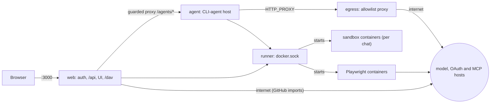

# Self-hosting hefyn

> hefyn is a proof of concept. Expect breaking changes between versions, with no migration promise. Back up before every upgrade (see "Backups and upgrades").

## Quick start (Docker)

You need Docker with Compose v2 and [Bun](https://bun.sh) (only for `bun run init`).

```sh
bun run init                           # creates .env with random secrets; never overwrites real values
docker compose --profile build build   # builds the shell-sandbox image (required, see below)
docker compose up --build
```

Open http://localhost:3000/setup. The first account becomes the Admin; sign-ups are closed after that and admins add people under **Settings > Users**.

Then, as Admin, under **Settings > Agents & keys**: install a coding agent (the default chat agent is Claude Code) and connect the API key it runs on.

**The sandbox image is required.** Every chat is a hosted CLI agent that runs in a per-conversation container started from the `hefyn-sandbox` image. The image is not pulled; it is built by the `build` profile above. Without it no chat can start.

`.env` (created by `bun run init`, mode 600):

| Variable | Meaning |
|---|---|
| `HEFYN_SECRET` | 32+ random characters. Signs sessions and, in the default key mode, is the root of all stored-data encryption. |
| `HEFYN_INTERNAL_TOKEN` | Shared secret between web, agent, runner and egress. Hex or base64url (it sits inside a proxy URL). |
| `HEFYN_URL` | The address users open, e.g. `https://hefyn.example.com`. Used for cookies, CSRF checks, passkeys, OAuth redirects and mail links. Default `http://localhost:3000`. |
| `HEFYN_KEY_MODE` | `server` (default) or `user`. See "Encryption" below. |
| `HEFYN_TRUSTED_PROXIES` | IPs/CIDRs of your reverse proxy (see below). |
| `HEFYN_SANDBOX_EGRESS` | `none` (default) or `internet` (see "Shell sandbox"). |
| `HEFYN_DRAIN_TIMEOUT_MS` | How long a requested agent restart waits for running tasks (default 600000). |
| `HEFYN_SKILLSMP_API_KEY` | Optional skillsmp.com key (more Hub search quota). |

Compose reads `.env` only for the `${...}` values in `docker-compose.yml`; there is no `env_file`. A variable that file does not mention (for example `HEFYN_MAX_UPLOAD_MB`, default 100, or `HEFYN_USER_QUOTA_MB`, default 1024, see [STORAGE.md](STORAGE.md)) reaches a container only if you add it to that service's `environment`. `.env.example` lists just `HEFYN_SECRET`, `HEFYN_INTERNAL_TOKEN`, `HEFYN_URL` and `HEFYN_DRAIN_TIMEOUT_MS`. Runner and install limits are in [SANDBOX.md](SANDBOX.md).

In production (`NODE_ENV=production`, set by the images) web and agent refuse to start with a missing, `dev-only` or short (< 32 chars) `HEFYN_SECRET` or `HEFYN_INTERNAL_TOKEN`; runner and egress check the token.

The compose project is named `hefyn`. Volumes from runs under an older project name (`agent_*`) are not picked up; remove them with `docker compose -p agent down -v`.

## Services and network



| Service | Role | Networks |
|---|---|---|
| `web` | auth, `/api`, UI, WebDAV, guarded proxy to the agent. The only published service (`:3000`). | `core`, `public` |
| `agent` | hosts the CLI agents (Claude Code, Codex, OpenCode, Pi) and their sign-in terminals | `core` only; leaves through `egress` |
| `egress` | forward proxy with a host allowlist derived from `app.db` (connected providers, OAuth token endpoints, MCP hosts) | `core`, `public`, `hefyn-mcp` |
| `runner` | the only holder of `docker.sock`; starts sandboxes, installer containers and Playwright | `core` |

`core` is Docker-internal (no route out). `public` and `hefyn-mcp` reach the internet. The runner has the Docker socket, which is root-equivalent on the host: it is reachable only on the internal network, behind the internal token, and starts fixed images with fixed flags. Details and risks: [SANDBOX.md](SANDBOX.md).

Model requests are forwarded as they are. There is no redaction service (removed 2026-10-26): personal data in a chat reaches the provider you connected. An upgrade from a version with the privacy layer drops its leftover tables (`redact_vars`, `redact_audit`) at the first start. The `redact-models` volume and the `HEFYN_REDACT_*` / `HEFYN_GLINER_*` settings are unused; remove them.

### Ports

| Port | Where | What |
|---|---|---|
| 3000 | `web`, published on all interfaces | UI, API, `/dav`. Put a reverse proxy in front for real use. |
| 127.0.0.1:1455 | `web`, published on loopback | Left over from "Sign in with ChatGPT": the sign-in flow is closed (see `connectors.oauth.start`), nothing listens on it in this version. It is only reachable from the Docker host anyway; you can remove the mapping from `docker-compose.yml`. |
| 4321 | dev stack only | Console with hot reload. |

Nothing else is published. A firewall should allow only your proxy (or 443) to reach 3000.

### Data

Data lives in two named volumes (with the project prefix, e.g. `hefyn_hefyn-data`):

- `hefyn-data` (`HEFYN_DATA_DIR=/data`): `app.db` (auth, roles, profiles, usage, hub, connectors, encrypted chat events), `users/<id>/{files,tmp}` (the user's files and per-chat scratch), and a leftover `flue.db` from the retired chat that nothing reads. Web and agent run as uid/gid 1000; volumes created by older versions need `docker run --rm -v <volume>:/d busybox chown -R 1000:1000 /d` once.
- `hefyn-agents`: the CLI agents an admin installed (the runner mounts it read-only; installer containers write it).

## Reverse proxy and client IPs

hefyn uses the socket peer as the client IP for rate limiting. Behind a reverse proxy, set `HEFYN_TRUSTED_PROXIES` (comma-separated IPs or IPv4 CIDRs of your proxies); only then are `X-Forwarded-For` / `X-Real-IP` believed. Without it those headers are stripped, and in plain Docker every user appears as the bridge gateway and shares one rate-limit bucket. Use Caddy, nginx or Traefik, terminate TLS there, and set `HEFYN_URL` to the public https address.

Pass through: `Host` unchanged, `X-Forwarded-For`, `X-Forwarded-Proto`, streaming responses without buffering (chat events and terminals are server-sent events).

**WebDAV (`/dav/`)**: forward it to `web` like `/api`, with every method (not just GET/POST): `OPTIONS PROPFIND PROPPATCH GET HEAD PUT DELETE MKCOL MOVE COPY LOCK UNLOCK`, and pass `Host` through unchanged (MOVE/COPY compare the `Destination` header's host with it). Do not cap request bodies below `HEFYN_MAX_UPLOAD_MB`, and turn off request buffering for uploads if your proxy allows it. Traefik and Caddy forward all methods by default; nginx needs no special `dav_methods` because it only proxies. Clients send HTTP Basic credentials (account email plus an app password), so `/dav` answers 403 unless the request came over https (the proxy must send `X-Forwarded-Proto: https`; plain http works only for `localhost`). Windows Explorer refuses WebDAV over plain http by default, so use a real certificate. Failed sign-ins are limited to 10 a minute per client IP and email.

## Shell sandbox

Every chat runs its agent in a container. People with the `sandbox.shell` permission may also use bash, grep and glob there and open the Files page. `sandbox.shell` is a **Worker default** (and Admin has it); a role without it gets no raw agent access and no Files page, only the Assistants that team admins grant an agent to. Design, limits and risks: [SANDBOX.md](SANDBOX.md).

**Egress:** sandboxes have no network at all by default (`HEFYN_SANDBOX_EGRESS=none`), so a prompt-injected model cannot send the files in a sandbox to a host of its choice. `HEFYN_SANDBOX_EGRESS=internet` opts in (for `git`, `npm`, `pip`). Then install the firewall rules so sandboxes cannot reach the host, your LAN or cloud metadata:

```sh
sudo scripts/sandbox-egress-rules.sh
```

Run it after the first sandbox has started (the runner creates the `hefyn-sandbox` network lazily), and again if that network is recreated. It uses `iptables` and `DOCKER-USER`; IPv6 is described at the end of the script. The rules are not persistent across reboots unless you save them with your distribution's tooling.

The browser connector (Playwright) always has internet access, in its own container; it is off until a user enables it and needs `mcp.run_managed`.

## Mail

hefyn can send password-reset and invite mails through one SMTP server (`src/server/channels.ts`; the sending happens in the web process, which needs outbound access to your SMTP host). **This build has no screen or API to configure it**: Settings > Mail and the `mail.*` API are gone, and the `channels.manage` permission has nothing to open. Until it returns, the sign-in page does not offer "Forgot your password?" and admins create accounts with a temporary password (**Users > Add a person**); the user must choose their own password at first sign-in.

## Two-factor and passkeys

Everyone can turn on an authenticator app (TOTP, with backup codes) and register passkeys under **Settings > Security**. Admins can require two-factor for admins or for everyone (Settings > Users); people who are required are sent to the Security page until it is on, and an admin can reset someone's two-factor if they lose their device. Passkeys are an extra way to sign in; "required" means an authenticator app.

Passkeys are bound to the exact address in the browser. Set `HEFYN_URL` to that origin; WebAuthn needs https, except on `localhost`. If the address changes, existing passkeys stop working.

## Encryption

`HEFYN_KEY_MODE` defaults to `server`: chat titles, chat events and stored secrets are encrypted in the database, and the keys are wrapped with a key derived from `HEFYN_SECRET`. That protects a stolen database or backup **without** `.env`. Whoever holds `.env` and the database can read everything, and an admin of the server can read everything. Do not keep `.env` next to your backups.

`user` mode (zero-access: keys wrapped by each user's password, recovery keys) exists in the server code, but its unlock screens moved to `old/`, so do not set it: users would be locked out. Details, limits and what is and is not encrypted: [ENCRYPTION.md](ENCRYPTION.md).

Losing `HEFYN_SECRET` makes the stored data unreadable in server mode. Do not change it on a running instance.

## Backups and upgrades

Back up, together and while stopped (or from a volume snapshot, as SQLite uses WAL):

- the `hefyn-data` volume (everything of your users);
- `hefyn-agents` (can be rebuilt by reinstalling the agents, but saves time);
- `.env` (`HEFYN_SECRET` is needed to read the data), stored apart from the data backup.

```sh
docker compose stop
docker run --rm -v hefyn_hefyn-data:/d -v "$PWD":/b busybox tar czf /b/hefyn-data.tgz -C /d .
docker compose start
```

(The volume name is `<project>_hefyn-data`; check with `docker volume ls`.)

Upgrading: take the backup, `git pull`, rebuild the sandbox image if `services/sandbox-image` changed (`docker compose --profile build build`), then `docker compose up --build`. There is no versioned migration plan: the database is upgraded in place at start, and a version may change or drop features. Read the commit log before upgrading, and keep the backup until you have checked the new version.

## Development

- **Docker with hot reload:** `bun run dev:docker`, open http://localhost:4321. Changes in `src/`, `web/src/`, `assets/` and `profiles/` reload in place; dependency or config changes rebuild only the affected service. The dev stack has its own data volume; if production runs on the same machine, add `-p hefyn-dev` to the compose command so the project names do not collide.
- **Without Docker:** `bun install && bun run dev` (agent on :5174, web API on :5173, console dev server with HMR on :4321). Everything runs on Bun >= 1.4.4 (pinned: `package.json` `engines`/`packageManager`, every Dockerfile `FROM oven/bun:1.4.4`; 1.4 has `node:sqlite`). The servers run the TypeScript sources directly, there is no server build; only the console is built (`bun run build` -> `dist/web`). Production commands: agent `bun src/agent.ts` (`bun run start`), web `bun src/web.ts` (`bun run start:web`).
- **Checks:** `bun run typecheck`, `bun run test` (every `test/*.test.ts` in its own `bun test` process, four at a time, one summary; `bun run test e2e hub` runs the files whose name contains one of the words, `HEFYN_TEST_JOBS` sets the parallelism; a fake model upstream, no API keys needed; the sandbox tests use Docker when available).

## Further reading

- [DESIGN.md](DESIGN.md): architecture and decisions
- [API.md](API.md): HTTP API
- [ENCRYPTION.md](ENCRYPTION.md): keys, what is encrypted, limits
- [SANDBOX.md](SANDBOX.md): shell sandbox and runner
- [HUB.md](HUB.md), [HUB-API.md](HUB-API.md): skill hub · [STORAGE.md](STORAGE.md): per-user storage
- [UI-DESIGN.md](UI-DESIGN.md): interface direction
