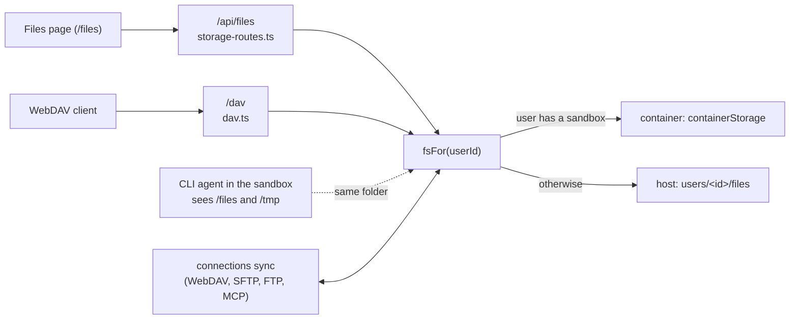

# Per-user storage

Code: `src/server/storage.ts` (core, host filesystem), `src/server/runner.ts` (`fsFor`: container or host), `src/server/storage-routes.ts` (the Files API), `src/server/dav.ts` (WebDAV), `web/src/components/Files.tsx` (the `/files` page), `test/storage.test.ts`, `test/files-routes.test.ts`, `test/files-container.test.ts`, `test/dav.test.ts`.

The storage add-ons (Settings, Storage) and the Files page of the old design moved to `old/` on 2026-10-27. What is described here is what runs today.

## Layout

`$HEFYN_DATA_DIR` (default `./data`)`/users/<userId>/files/` persistent, `.../tmp/<conversationId>/` scratch.
Agents see `/files/...` and `/tmp/...` (tmp = the current conversation's dir); everything else is rejected. Dirs are created lazily.

| Env | Default | Meaning |
|---|---|---|
| `HEFYN_USER_QUOTA_MB` | 1024 | per user, `files/` + `tmp/` |
| `HEFYN_MAX_UPLOAD_MB` | 100 | single file |

## The Files page

`/files` in the console (permission `sandbox.shell`, the same as the agent sandbox that mounts the folder) is the user's own view of `/files`: list, upload (drag and drop too), download, new folder, rename, delete, quota bar. Only `/files` is exposed, never `/tmp`. The API (`/api/files/*`, see `docs/API.md`) always works on the signed-in user's folder; the owner is never a request parameter. For a user with a sandbox the operations run inside their container (`fsFor` -> `containerStorage`); a runner that is down or still starting answers 503 and the page shows "Starting your workspace". The page also has the "Connect storage" button and the menus for connection folders (`web/src/components/Connections.tsx`, see "Connections" below); there is no separate connections page.

## Access from other apps (WebDAV)

`https://<host>/dav/` serves the user's `/files` over WebDAV (Mac Finder "Connect to Server", Windows "Map network drive", Nextcloud/ownCloud apps, Cyberduck, WinSCP, rclone). Same permission as the Files page (`sandbox.shell`). Sign-in is HTTP Basic: username = the account email, password = an **app password** made under Settings, Connected apps (`appPasswords.*`, `docs/API.md`). App passwords are minted by the server (32 characters, shown once, stored as a salted scrypt hash), read-only or read-write, revocable, at most 20 per user. The account password and the session cookie are never accepted on `/dav`, so a web page cannot ride a logged-in browser into it. Failed sign-ins are limited to 10 a minute per IP and email and logged. Plain http is refused except on localhost. GET answers are always `application/octet-stream` + `attachment` + `nosniff` + CSP sandbox, because `/dav` shares the console origin.

Supported: OPTIONS, PROPFIND (Depth 0 and 1; `infinity` is refused), PROPPATCH (accepted, nothing stored), GET/HEAD (single Range), PUT, DELETE, MKCOL, MOVE, COPY (same user, `Destination` on the same host under `/dav`), LOCK/UNLOCK. Locks are fake: a token is returned so Finder and Windows will write, but nothing is held, so two clients can overwrite each other. Symlinks are not listed. Upload size and quota are the same as in the console (413).

## Connections (WebDAV, SFTP, FTP, MCP)

A connection syncs a remote folder both ways into the user's own `/files/<name>/`. The agent sandbox has no internet, so the hefyn server does the network traffic and agents see plain files (bash, grep and edit all work). Connections are private to one user; permission `sandbox.shell`. Code: `src/server/connections/` (`types.ts` the `Adapter` and `StorageProvider` interfaces, `webdav.ts`, `sftp.ts`, `ftp.ts`, `mcp.ts`, `store.ts` the table and API logic, `sync.ts` the engine), `src/modules/connections.ts`, `src/server/routers/connections.ts` (API: `docs/API.md`), `test/connections.test.ts`, `test/sync.test.ts`.

Kinds are registered by built-in modules with `ctx.storage` (slot `storageProviders`, `docs/MODULES.md`). Installed modules cannot run server code, so third parties extend Files with a remote MCP server, which the `mcp` kind uses (the official filesystem server's tool names: `list_directory[_with_sizes]`, `read_text_file`, `write_file`, `create_directory`, `move_file`, `get_file_info`; binary answers as base64 are read, writes are text only; listings carry no times, so changes there are detected by size).

| Kind | Notes |
|---|---|
| `webdav` | Nextcloud: `https://host/remote.php/dav/files/<user>/` with an app password. https only, no credentials in the URL, redirects only inside the configured origin. |
| `sftp` | Password or private key. The SHA-256 fingerprint of the host key is stored with the connection on the first successful connect (trust on first use); a changed key is refused. Editing host or port pins afresh. |
| `ftp` | Explicit FTPS (certificate checked) is required. Plain FTP sends the password unencrypted and only works if the admin sets `HEFYN_ALLOW_PLAIN_FTP=1`. |
| `mcp` | One of the user's own MCP servers (Settings, MCP) with filesystem tools. |

Creating a connection tests it first (connect and list the remote folder) and refuses when that fails. The display name becomes the folder name (path characters replaced, at most 60); it must be unique and must not collide with an existing folder in `/files`. Renaming later changes the display name only. Secrets (passwords, keys) are sealed with the user's key (AAD `conn:<id>:<userId>`), never returned by any API (the list only says which secret fields are set) and are lost with "start fresh" like other sealed data. Deleting a connection never touches the remote; the local copy stays unless the user asks to remove it.

### How the sync works

Both sides are listed completely and compared with what the last run saw (`connection_state`: remote etag or mtime and size, local mtime and size, per path). The first run has no history: everything remote comes down, everything local-only goes up.

| Remote | Local | Result |
|---|---|---|
| changed | unchanged | download |
| unchanged | changed | upload |
| changed | changed | **conflict**: the remote version keeps the name, the local version is renamed `name (conflict yyyy-mm-dd hhmm).ext` and uploaded under that name too; nothing is lost on either side (files with the same size and bytes are no conflict) |
| new | none | copy to the other side |
| deleted | unchanged | delete locally |
| unchanged | deleted | delete remotely |
| deleted | changed | the changed file is restored (uploaded) |
| changed | deleted | the changed file is restored (downloaded) |

A folder deleted on one side is deleted on the other only when nothing is left in it after the run. Symlinks are never followed; names the other side may refuse (`\ : * ? " < > |`, control characters, trailing dot or space, over 255 bytes) are skipped and counted. Files over `HEFYN_MAX_UPLOAD_MB` are skipped. All local writes go through the per-user fs layer, so the quota applies: when it is full the run stops with a clear message. Reading a listing that fails stops the whole run before anything is changed, so a flaky server is never read as "everything deleted".

Limits per run: 10 000 files and folders on either side (`HEFYN_SYNC_MAX_ENTRIES`; more aborts the run with no changes, pick a smaller remote folder), folder depth 20, 500 MB transferred (`HEFYN_SYNC_MAX_MB`; the rest follows on the next run, the summary says `capped: bytes`). One run per connection at a time (a lock row in the database, so web and agent process agree; a lock older than 15 minutes is ignored). Errors on single files are listed in the summary and do not stop the run. Files are held in memory while they transfer.

Triggers: `connections.syncNow`; a background job every 5 minutes for connections of users who were active in the last hour (chats or the connections API); a bounded pull (at most 10 s, uploads skipped) before an agent process starts in a chat; and a push (fire and forget) after each agent turn.

| Env | Default | Meaning |
|---|---|---|
| `HEFYN_ALLOW_PRIVATE_URLS` | off | Every kind resolves the host and refuses private, loopback and link-local addresses. Set `1` when a NAS or server on your own network is meant (also allows http for WebDAV). |
| `HEFYN_ALLOW_PLAIN_FTP` | off | Allow unencrypted FTP. |
| `HEFYN_SYNC_MAX_ENTRIES` | 10000 | files and folders per side |
| `HEFYN_SYNC_MAX_MB` | 500 | transferred per run |

Security notes: the sync runs in the hefyn server process, so connection hosts are **not** on the sandbox egress allowlist and agents cannot reach them; they only see files. Content that agents read from synced files reaches the model like any other file. The address check and the connection resolve the host name separately, so DNS rebinding in between is not covered (same as MCP connectors). A synced file is as trusted as its remote: a malicious server can put any content into `/files/<name>/`.

## Security checks (all tested)

`..` segments, absolute paths outside `/files` `/tmp`, backslashes, NUL, path/segment length, user/conversation id charset,
symlinks to outside (existing, via a directory, dangling, deep new path), realpath on the deepest existing ancestor for every op,
`rm`/`rename` act on the link itself (never follow), roots cannot be removed, downloads are `application/octet-stream` + `attachment` + `nosniff` + CSP sandbox.

## Known limits

- TOCTOU between realpath check and use is not closed (needs a local attacker able to create symlinks; the agent has no shell).
- Quota is computed by walking the tree on each write (fine for small areas; cache if it gets slow). Concurrent writes can overshoot slightly.
- Uploads are buffered in memory (max `HEFYN_MAX_UPLOAD_MB` per file; Hono parses the whole form first).
