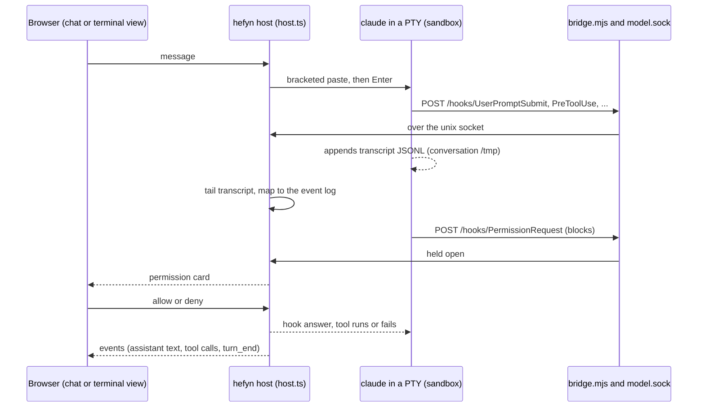
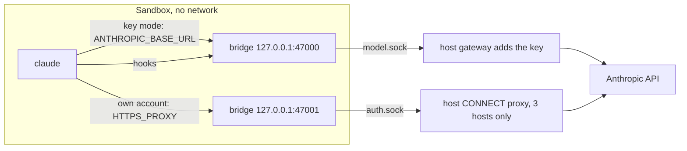

# Agent wrapper

hefyn runs the agents' own, unmodified CLIs and wraps them: a terminal for the agent's own screen and a chat built from
the agent's own hooks and transcript. hefyn does not drive Claude Code through the Agent SDK or ACP, does not handle a
user's Claude login, and does not sit between Claude Code and Anthropic when a user signs in with their own account.

Owner decision (2026-10-26): "unmodified Claude Code, a wrapper makes the chats". Code: `src/cli-agents/host.ts` (the
session), `claude-wrapper.ts` (hook and transcript mapping), `own-account.ts` (own-account launch and proxy),
`team-accounts.ts` (which account a session uses), `services/sandbox-image/` (managed settings, bridge).

## Why (Anthropic's rules, checked 2026-10-26)

- Hosting Claude Code in sandboxes is allowed if the binary is unmodified and no built-in sign-in method is removed or
  restricted ([legal and compliance](https://code.claude.com/docs/en/legal-and-compliance)).
- End users may sign in to that unmodified binary with their own subscription. A host may not "collect, store, or
  intermediate Claude.ai credentials or session tokens"; sign-in completes through Anthropic's own flow.
- Products built on the Agent SDK may not offer claude.ai login without Anthropic's approval
  ([Agent SDK overview](https://code.claude.com/docs/en/agent-sdk/overview.md)). So the chat must not be built on the SDK.
- A company may configure its own API key for its own staff, billed to the key owner.

## One process, two views

Each Claude Code conversation has one PTY in the user's sandbox running the unmodified `claude` binary
(`--session-id <uuid>` on first start, `--resume <uuid>` after). Both views attach to that same process:

- **Terminal view**: the PTY, as today.
- **Chat view**: rendered from Claude Code's hooks and transcript. Typing in the chat composer sends the text into the
  PTY (bracketed paste, then Enter). Stop sends Esc. Switching views never restarts anything.

## What the chat is built from

- **Hooks** (official, configured in the sandbox image's managed settings, `services/sandbox-image/managed-settings.json`,
  root-owned so users can't remove them): `http` hooks to `http://127.0.0.1:47000/hooks/<event>`. The bridge
  (`bridge.mjs`) forwards them over the conversation's unix socket to the host. Events configured: `SessionStart`,
  `SessionEnd`, `UserPromptSubmit`, `PreToolUse`, `PermissionRequest`, `PostToolUse`, `PostToolUseFailure`,
  `Notification`, `Stop`, `StopFailure`, `SubagentStart`, `SubagentStop`. `allowedHttpHookUrls` limits hooks to that
  URL. Hooks never change content; they only report, and answer permission questions with the user's choice from the chat.
- **Transcript**: every hook carries `transcript_path`; the host reads new lines of that JSONL file (it lives in the
  conversation's /tmp on the data volume) for the assistant's text, thinking, tool calls and results.
- The host maps both onto the conversation event log in the shape the chat already renders (`agent_message_chunk`,
  `agent_thought_chunk`, `tool_call`, `tool_call_update`, `{hefyn:'permission'}`, `turn_start`, `turn_end`,
  sub-agent tool calls), so CliChat, RunCard and activity keep working.

## Sign-in and model traffic

Which account a session uses (`host.ts` `chooseMode`, `team-accounts.ts` `resolveMode`), in this order:

1. **Own Claude account**: the user is signed in (`/claude-home/.credentials.json` is non-empty, asked of the sandbox with
   `test -s`; hefyn never reads it).
2. **Team login**: an admin signed a shared team login in, and the user's role may use it (`accounts.team`). Claude Code's
   manifest says `sharedLogin: false` (Anthropic's terms); an admin can still enable it after an explicit warning (see
   "Agent accounts" below).
3. **Team API key**: the key an admin connected, if the user's role may use it. The model goes through the gateway.
4. Otherwise a plain message saying what is missing.

Unattended runs (schedules, flow steps) skip 1 and 2 and use the key only.

- **API key mode**: `ANTHROPIC_BASE_URL` points at the bridge (`127.0.0.1:47000` in the sandbox), the gateway injects the key.
  The real key never enters the sandbox. The sandbox has no network of its own; the bridge pipes to a unix socket
  (`<data>/users/<uid>/tmp/<conv>/.hefyn/model.sock`) that the host serves.
- **Own Claude account**: the user signs in with Claude Code's own `/login` (terminal view, or the sign-in dialog in Settings,
  Agent accounts, which is an embedded terminal running `claude auth login`). The credentials stay in a per-user Claude home
  (`<data>/users/<uid>/claude-home`, `/claude-home` in the sandbox), mounted only into that user's sandboxes; no hefyn process
  reads, copies or forwards it. There is no gateway and no base URL override. Claude Code gets `HTTPS_PROXY=127.0.0.1:47001`:
  the bridge's second port, piped to `/tmp/.hefyn/auth.sock`, where the host runs an HTTPS CONNECT proxy
  (`own-account.ts` `createAuthProxy`) that tunnels only to `api.anthropic.com`, `platform.claude.com` and `claude.ai` (port 443)
  and refuses everything else.
- hefyn does not restrict Claude Code's sign-in methods. Admins choose which keys exist, not whether a person may sign in.

## Flows and Assistants

Assistant steps on Claude Code run the same wrapper. Unattended runs (schedules, flow steps nobody is watching) use API
keys only: Anthropic sizes subscriptions for ordinary individual use.

## Other agents

Codex, OpenCode and Pi run through their ACP adapters, on API keys through the gateway (not on a personal or team login).
Moving them to the same wrapper (their own TUIs plus their own event streams or transcripts) is Planned.

## Removed by this change

`claude-agent-acp` for Claude Code, the gateway's forwarding of a user's subscription bearer, hefyn's sealed store of
users' Claude credentials, and the sign-in relay that parsed the CLI's output. Also gone with them: the admin's "who may
sign in" switches (`agents.update personalSignIn`, `agents.people`), Codex's personal sign-in (it lived on the same store
and bearer forwarding), the `expired`/`auth_expired` tracking and the terminal's "use your own account" bar. The
`cli_agents.personal_signin` column is left unused.

## As built (2026-10-26)

Everything below was measured with the real Claude Code **2.1.310** (npm `latest` that day; `stable` was 2.1.308), Linux
arm64 in Docker, against a local stand-in model. No real model API, account or credential was touched.

### Verified facts

- **Hook events** that exist in this binary: `PreToolUse PostToolUse PostToolUseFailure PostToolBatch Notification
  UserPromptSubmit UserPromptExpansion SessionStart SessionEnd Stop StopFailure SubagentStart SubagentStop PreCompact
  PostCompact PreModelSwitch PostModelSwitch PermissionRequest PermissionDenied Setup TeammateIdle TaskCreated
  TaskCompleted Elicitation ElicitationResult ConfigChange WorktreeCreate WorktreeRemove InstructionsLoaded CwdChanged
  FileChanged DirectoryAdded MessageDisplay`. A permission event **exists**: `PermissionRequest`.
- **`http` hooks fire in the interactive TUI** (`POST http://127.0.0.1:47000/hooks/<event>`, JSON body with `session_id`,
  `transcript_path`, `cwd`, `prompt_id`, `permission_mode`, `hook_event_name` and the event's fields), also with
  `HTTPS_PROXY` set when `NO_PROXY` has 127.0.0.1. Seen firing: `UserPromptSubmit PreToolUse PermissionRequest
  PostToolUse Stop StopFailure Notification SubagentStart SubagentStop`. **`SessionStart` did not fire** for an http hook
  (start or resume); hefyn does not need it (the managed settings still list it). A `{}` answer means "no opinion".
- **`PermissionRequest` blocks while the hook answers**: `{hookSpecificOutput:{hookEventName:"PermissionRequest",
  decision:{behavior:"allow"}}}` runs the tool (the file was written only after the answer), `behavior:"deny", message`
  fails it with that message (the tool_result is `is_error`, `PostToolUse` fires with `tool_response: "Error: <message>"`),
  `allow` with `updatedPermissions` (Claude Code's own `permission_suggestions`, e.g. `setMode acceptEdits`) switches
  the mode for the session. The TUI draws **its own dialog at the same time**; if the terminal answers first the tool
  runs, and **Claude Code does not abort the pending hook request**: the host releases it with `{}`. A
  `PermissionRequest` payload has **no `tool_use_id`**: it is matched to the latest unfinished `PreToolUse` of the same
  tool name and input. No `PreToolUse` `permissionDecision: "ask"` is needed.
- **Sub-agents**: the tool is named `Agent` (older: `Task`); tool hooks inside a sub-agent carry `agent_id`; a sub-agent
  may run in the background, and its end starts another turn (a `UserPromptSubmit` whose prompt is a
  `<task-notification>`), so one chat message can be followed by turns Claude Code made up.
- **Stop does not fire on an interrupt.** Esc during a model call puts the unsent prompt back into the composer and
  writes nothing (no transcript line, no hook); Esc during a permission dialog or a running tool writes the tool_result
  "The user doesn't want to proceed..." and a user line `[Request interrupted by user for tool use]`. A second Esc on a
  non-empty composer shows "Esc again to clear". **Ctrl-C clears the composer** (on an empty one it only shows "Press
  Ctrl-C again to exit": one press is harmless, two exit; hefyn sends it only once, after a Stop).
- **Transcript**: `transcript_path` = `<config dir>/projects/-files/<session id>.jsonl` (`-files` = the cwd `/files`),
  JSONL, appended as it happens, written **before** the hook that is about it. One `assistant` line per content block
  (`thinking`, `text`, `tool_use`), `user` lines with `tool_result` blocks (`is_error`, `toolUseResult`) and the prompt
  (string content), `system`/`turn_duration` at the end of a turn (after `Stop`), plus many non-chat types
  (`attachment`, `api-request`, `mode` ...). Sub-agents write their own file (`<sid>/subagents/agent-<id>.jsonl`,
  `isSidechain: true`), which hefyn reads as that sub-agent's **lane** (since 2026-10-27): `SubagentStart` makes the lane (paired in order with the unclaimed `Agent` tool call, which gives the description), the file and the hooks that carry `agent_id` fill it, `SubagentStop` ends it. Lane events are in the same sealed log with `agent: <id>` in the update, plus `{hefyn:'subagent', agentId, status, type, description, toolCallId}`; the chat shows them in a "Session" dropdown. A sub-agent's permission question is a card in the main view (`by: <id>`) that outlives the turn that started it. "Allow for this session" rewrites every suggestion's destination to `session` (the suggestions may name `localSettings`, a file in the shared `/files`). An API error is an `assistant` text line `API Error: 400 ...` and the
  `StopFailure` hook (`error`, `last_assistant_message`).
- **`--session-id <uuid>` / `--resume <uuid>`** both work and keep the id and the transcript file; after `--resume` the TUI
  shows the history and the next hook has the same `session_id`.
- **Bracketed paste + Enter** submits reliably: tried as two writes 300 ms apart, 50 ms apart, back to back and as one
  write; multi-line text arrives intact (`"line one\nline two\n\nline four"`). Without the bracket, text and Enter
  together would look like a paste (the old terminal test).
- **Defaults that matter**: Claude Code 2.1.310 starts in **auto mode** and shows a "Make auto mode your default permission
  mode?" dialog; `permissions.defaultMode: "default"` plus `hasSeenAutoDefaultNudge: true` in `.claude.json` give the
  "asks before acting" behaviour and no dialog. `/tmp` with mode 0777 makes it print a harmless "cross-session messaging
  is off" warning (the runner's `/tmp` is 0755).
- **Own account**: the login is `$CLAUDE_CONFIG_DIR/.credentials.json`; `claude auth status` prints JSON (`loggedIn`,
  ...; exit 1 when signed out), `claude auth logout` exits 0, `claude auth login` prints the sign-in URL (as an OSC 8 link
  and as text) and `Paste code here if prompted >`; none of the three connects to anything before the code is pasted.
  Behind a refusing proxy the TUI and a prompt asked for `api.anthropic.com:443` (model, profile), `downloads.claude.ai:443`
  (update check) and `github.com:443` (plugin marketplace); the login's token endpoint is `platform.claude.com`. With
  `CLAUDE_CONFIG_DIR=/claude-home` the `projects` entry can be a link to `/tmp/.claude/projects`: Claude Code wrote its
  transcript through it (the hook payload still names the `/claude-home/...` path, so hefyn builds the path itself).

### Decisions

- **Id and distribution.** The agent id stays `claude-acp` (rows, Assistants, conversations); the package is
  `@anthropic-ai/claude-code`, installed pinned by the existing installer (no scripts: the manifest runs the platform
  binary `node_modules/@anthropic-ai/claude-code-linux-<cpu>/claude`), updated automatically to npm's `latest`
  (`registry.ts withClaudeCode`, `HEFYN_NPM_REGISTRY_URL` for a mirror; a deployment that sets `HEFYN_ACP_REGISTRY_URL` and
  no npm URL stays on the bundled 2.1.310).
- **Managed settings** (image, `/etc/claude-code/managed-settings.json`): the 12 http hooks listed above and
  `allowedHttpHookUrls` = `http://127.0.0.1:47000/hooks/*` only; `disableAllHooks` untouched; **`WebSearch` and `WebFetch`
  stay denied in every mode** (`permissions.deny`; no network in API-key mode, the gateway refuses server tools; in
  own-account mode WebFetch cannot pass the proxy and WebSearch would be Anthropic-side; one policy, an admin who wants it
  edits `managed-settings.json` in the image). No sign-in method is removed or restricted.
- **Modes per session**: the order under "Sign-in and model traffic". Flows, schedules and Assistant-as-tool runs are
  unattended, so key only.
- **Claude home shared by a user's chats**: the Assistant's instructions, skills and model go into it on the own account, so
  concurrent chats of one user with different Assistants overwrite each other (the latest start wins). Accepted for now.
- **AskUserQuestion** is not answerable from the chat: the hook is released with `{}`, the chat says to open the terminal.
- **Chat text is per block, not per token**: the transcript has whole blocks.
- **Hooks are untrusted input** (anything in the sandbox can post to the socket): a payload must carry the session's own
  uuid, never chooses a path, and only drives the log of its own conversation.

### Not verified

A real sign-in, a real token refresh through the proxy, a real model turn on a subscription, Claude Code's behaviour on a
real streaming model with long turns (stand-in only), `AskUserQuestion`/plan-mode dialogs, `/` commands pasted as chat
text, sessions that outlive a Claude Code update, and hooks from other Claude Code versions (the test image pins what the
installer installs; bumping the version means re-running `test/cli-agent-wrapper.test.ts`).

## Agent accounts (Settings, Agent accounts)

Every agent manifest may carry a `login` block (`src/modules/agent-manifest.ts`): the agent's own login, status and logout commands, the flow
(`code`: an address, then a code pasted into the CLI's prompt; `device`: an address and a code to type on that page; `terminal`: menus, the CLI's own
terminal is shown), the account home (config-dir env var and directory), the hosts the egress proxy may reach, and whether the steps are `verified`.

- **Sign-in without a terminal**: hefyn runs the login command in the user's account sandbox (`src/cli-agents/account.ts`), reads the address and device
  code off its screen, shows a button, and types a pasted code into the CLI's own prompt. Success is the agent's status command (or a size test of
  one file for `format: file`). Output and code live in memory and are dropped when the sign-in ends; the credential files are never opened by hefyn.
- **Account homes**: `users/<uid>/accounts/<agent>` at `/accounts/<agent>` in that user's sandboxes (Claude Code keeps its older `/claude-home`);
  team homes `team-accounts/<agent>` at `/team-accounts/<agent>`, mounted only for roles the admin allowed and for admins with `accounts.team`.
- **Team accounts** (`accounts.team`, `src/cli-agents/team-accounts.ts`): per agent a team API key and a shared team login, each with a role list.
  The shared login needs `sharedLogin: true` in the manifest (OpenCode, Pi); Claude Code and Codex say `false` (their terms forbid sharing a personal
  subscription) and an admin can still enable it after an explicit warning, which is stored (`login_override`).
- **Mode per session** (`resolveMode`): personal login, else the team login (role allowed, team signed in), else the team API key (role allowed), else a
  plain message. Personal sign-in is never restricted by role; unattended runs (schedules, flows) use the key only.
- **Verified** against the installed binaries: `claude auth login|status|logout`, `opencode auth login|list` (0 credentials output). **From docs only**:
  `codex login --device-auth`, `codex login status`, `codex logout`, Pi's `/login` and its `auth.json`, every host list except Claude Code's, and the
  exact text the CLIs print around the address (the parsers look for the first https address and a code pattern).
- **Not wired yet**: chats of the ACP agents (Codex, OpenCode, Pi) still run on keys; their personal or team home is signed in and managed here,
  but only Claude Code's chat (the PTY wrapper) switches to it.
